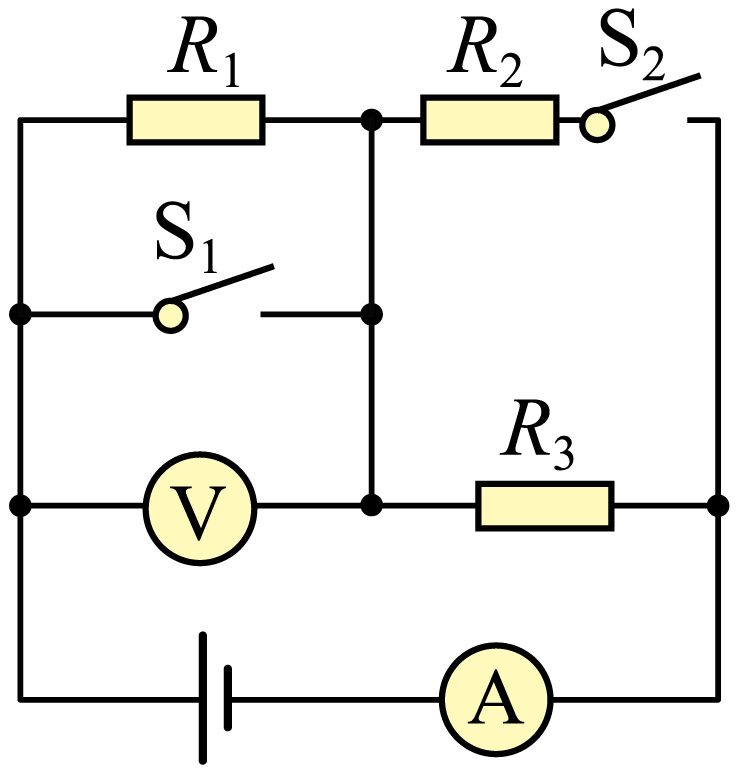

# Physics - 题目 2697

**ID**: 52fd103f5bce4de099cb28148484bc07
**年级**: Grade 9
**难度**: Medium
**题型**: Calculation

## 题目
如图所示， $R{{}_{2}}=R{{}_{3}}=20Ω$ ，当S_{1}和S_{2}都断开时，电流表的示数为0.4A，电压表的示数为4V，求：（1）R_{1}的阻值。​​​​​​​‌（2）电源电压。（3）S_{1}和S_{2}都闭合时电压表和电流表的读数。

## 解答

1. （1）当S_{1}和S_{2}都断开时，R_{1}与R_{3}串联_{，}电流表的示数为0.4A，电压表测量R_{1}两端电压，R_{1}的阻值 $R{{}_{1}}=\frac {U{{}_{1}}}{I}=\frac {4{\rm{V}}}{0.4{\rm{A}}}=10{\rm{Ω}}$ 。
2. （2）电源电压 $U=I\left ({R{{}_{1}}+R{{}_{3}}}\right )=0.4{\rm{A}}\times \left ({10{\rm{Ω}}+20{\rm{Ω}}}\right )=12{\rm{V}}$ 。
3. （3）S_{1}和S_{2}都闭合时，R_{2}与R_{3}并联_{，}电压表测量导线两端电压，所以电压表示数 $U{{}_{{\rm{V}}}}=0{\rm{V}}$ ，电流表在干路上，读数 $I{{}_{并}}=\frac {U}{R{{}_{2}}}+\frac {U}{R{{}_{3}}}=\frac {12{\rm{V}}}{20{\rm{Ω}}}+\frac {12{\rm{V}}}{20{\rm{Ω}}}=1.2{\rm{A}}$ 。

## 知识点

**中文**:
  - 欧姆定律的应用

**English**:
  - Applications of Ohm's Law

---
