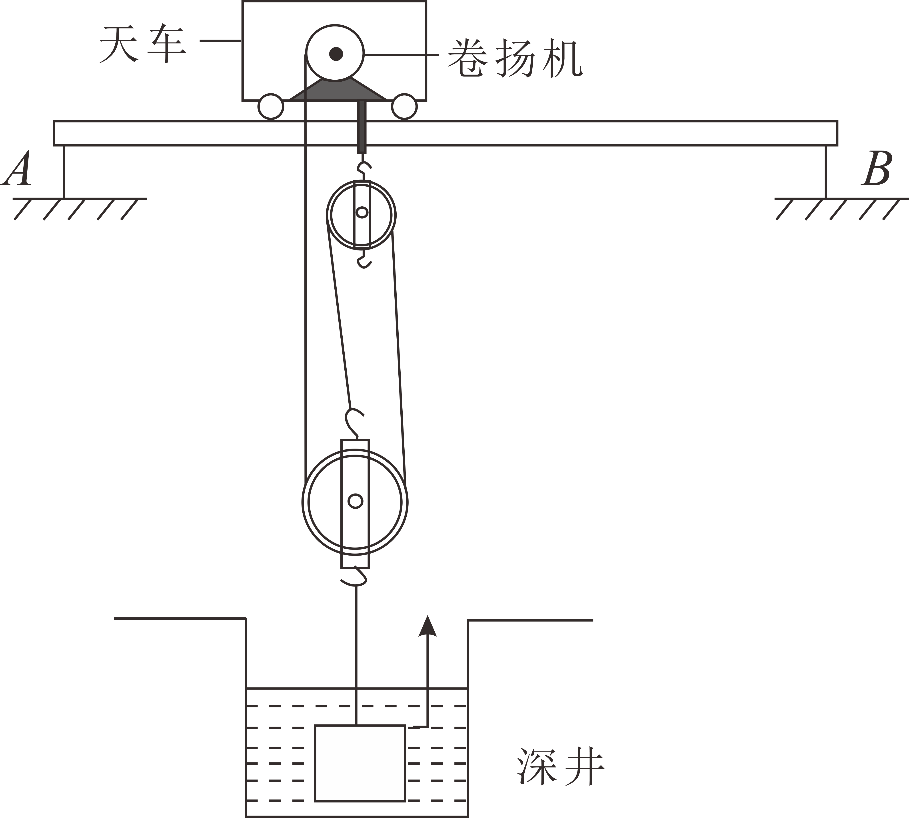

# Physics - 题目 625

**ID**: 544198730012447c9d406553e3b9e21d
**年级**: Grade 9
**难度**: Medium
**题型**: Calculation

## 题目
如图所示是可以在导轨AB上移动的天车。​​​​​​​‌天车上的卷扬机（其内部有电动机提供动力）通过滑轮组提升重物。导轨AB长15m。现用此天车匀速提升水下一质量为0.81t的货物。货物浸没在水中时受到的浮力为2700N，卷扬机对钢绳的拉力为2300N。不计钢绳重及摩擦，不考虑水对货物的阻力。（1）货物的密度是多少？（2）图中天车（含滑轮组）的重心所在位置距A端的水平距离为3m，物体浸没在水中时，支架对导轨A端的支持力为8000N，求天车和滑轮组的总重力是多少？（3）当卷扬机将货物提升离开水面后，天车中滑轮组的机械效率是多少？

## 解答

1. 解：（1）由题意可知，货物的质量为
2. m_{货}=0.81t=810kg
3. 货物浸没在水中时，货物排开水的体积等于货物的体积，根据阿基米德原理可得，货物的体积为
4. $V{{}_{货}}=V{{}_{排}}=\frac {F{{}_{浮}}}{ρ{{}_{水}}g}=\frac {2700{\rm{N}}}{1.0\times 10{{}^{3}}{\rm{k}}{\rm{g}}/{\rm{m}}{{}^{3}}\times 10{\rm{N}}/{\rm{k}}{\rm{g}}}=0.27{\rm{m}}{{}^{3}}$
5. 所以货物的密度为
6. $ρ{{}_{货}}=\frac {m{{}_{货}}}{V{{}_{货}}}=\frac {{\rm{8}}{\rm{1}}{\rm{0}}{\rm{k}}{\rm{g}}}{{\rm{0}}{\rm{.}}{\rm{2}}{\rm{7}}{\rm{m}}{{}^{{\rm{3}}}}}=3\times 10{{}^{3}}{\rm{k}}{\rm{g}}/{\rm{m}}{{}^{3}}$
7. （2）不考虑水对货物的阻力，导轨AB相当于杠杆，当AB处于水平位置时，以B为支点，动力为A端受到的支持力F_{支}，动力臂为AB，阻力为天车和滑轮组对AB的压力F_{压}，阻力臂l_{阻}为B点到压力作用点的距离，为
8. l_{阻}=15m-3m=12m
9. 且F_{压}=G_{总}+G_{货}-F_{浮}，货物的重力为
10. G_{货}=m_{货}g=810kg×10N/kg=8100N
11. 由杠杆平衡条件：动力 $\times $ 动力臂=阻力 $\times $ 阻力臂可得，F_{支}×AB=F_{压}×l_{阻}，即
12. 8000N×15m=（G_{总}+8100N-2700N）×12m
13. 解得：G_{总}=4600N。
14. （3）由图可知，该滑轮组的承重段数n=3，所以货物浸没在水中时，由动滑轮和货物的受力关系G_{货}+G_{动}=nF_{拉}+F_{浮}可得
15. G_{货}=nF_{拉}+F_{浮}-G_{动}=3×2300N+2700N-8100N=1500N
16. 货物离开水面后，不计钢绳重及摩擦，动滑轮和货物的受力关系为G_{货}+G_{动}=nF′_{拉}，所以滑轮组的机械效率为
17. $η=\frac {W{{}_{有}}}{W{{}_{总}}}\times 100\%=\frac {G{{}_{货}}}{nF{{}_{拉}^{\prime }}}\times 100\%=\frac {G{{}_{货}}}{G{{}_{货}}+G{{}_{动}}}\times 100\%=\frac {8100{\rm{N}}}{8100{\rm{N}}+1500{\rm{N}}}\times 100\%=84.375\%$
18. 答：（1）货物的密度是 $3\times 10{{}^{3}}{\rm{k}}{\rm{g}}/{\rm{m}}{{}^{3}}$ 。
19. （2）天车和滑轮组的总重力是4600N。
20. （3）天车中滑轮组的机械效率是84.375%。

## 知识点

**中文**:
  - 密度公式的应用
  - 阿基米德原理的应用
  - 杠杆平衡条件的应用
  - 滑轮（组）的机械效率及其计算

**English**:
  - Application of Density Formula
  - Applications of Archimedes' Principle
  - Application of Lever Equilibrium Conditions
  - Mechanical Efficiency of Pulleys and Calculations

---
