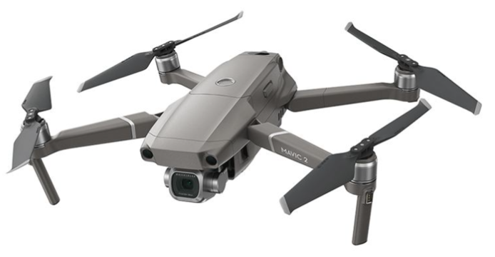

# Physics - 题目 2171

**ID**: 5478a973cb8147d29ac55df1aa8b6102
**年级**: Grade 9
**难度**: Medium
**题型**: Calculation

## 题目
在新冠肺炎暴发期间，为了控制疫情居民尽量在家减少外出，有的村庄动用航拍无人机对村里公共场所进行监控。​​​​​​​‌某村使用的无人机整机质量约 200g，采用 3.7V 的锂离子电池。某次航拍连续飞行 20min，飞行 1500m，消耗 2.22×10^{4}J 的能量，假设无人机消耗的功率恒定。（g取 10N/kg）求：（1）无人机飞行的平均速度；（2）无人机在这段时间内的电流；（3）无人机上升 50m，克服重力所做的功。

## 解答

1. (1)无人机飞行的平均速度
2. $v=\frac {s}{t}=\frac {1500{\rm{m}}}{20\times 60{\rm{s}}}=1.25{\rm{m}}{\rm{/}}{\rm{s}}$
3. (2)据W=UIt得
4. ${\rm I=\frac {W}{Ut}=\frac {2.22\times 10{^{4}}{\rm J}}{3.7V\times 20\times 60{\rm{s}}}=5{\rm{A}}}$
5. (3)无人机上升50m克服重力所做的功
6. W_{1}=Gh=mgh=0.2kg×10N/kg×50m=100J
7. 答：(1)无人机飞行的平均速度为1.25m/s；
8. (2)无人机在这段时间内的电流是5A；
9. (3)克服重力所做的功是100J。

## 知识点

**中文**:
  - 功的计算和估算
  - 速度公式及其应用
  - 电功与电能的计算

**English**:
  - Calculation and Estimation of Work
  - Velocity Formula and Applications
  - Calculation of Electric Work and Energy

---
