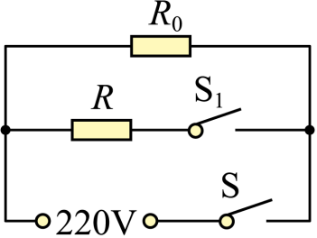

# Physics - 题目 1927

**ID**: 57900802ee23439797ca61e76cd453e3
**年级**: Grade 9
**难度**: Medium
**题型**: Calculation

## 题目
如图是电饭锅工作原理的简化电路图，电饭锅有两档，分别是高温烧煮和低温焖饭，S_{1}为档位自动控制开关，R_{0}和R均为电热丝，R_{0}的阻值为1210Ω，该电饭锅铭牌技术参数如表所示（低温焖饭档额定功率模糊不清）．求：某型号电饭锅额定电压220V额定功率高温烧煮840W低温焖饭电源频率50Hz（1）电饭锅高温烧煮0.5h消耗的电能；（2）电饭锅低温焖饭时的额定功率；（3）电热丝R的阻值。​​​​​​​‌

## 解答

1. 解：(1)由表格中的数据可知，电饭锅高温烧煮的功率P_{高}=840W，烧煮时间
2. t=0.5h=1800s，电饭锅高温烧煮消耗的电能W=P_{高}t=840W×1800s=1.512×10^{6}J。
3. (2)当开关S闭合、S_{1}断开时，仅有R_{0}接入电路，电路电阻较大，电压一定时，电路电阻越大，电功率越小，此时电饭锅处于低温焖饭状态；电饭锅低温焖饭时的额定功率P_{低}= $\frac {U{^{2}}}{R{{}_{0}}}=\frac {(220{\rm{V}}){^{2}}}{1210Ω}$ =40W。
4. (3)当开关S、S_{1}都闭合时，电热丝R、R_{0}并联接入电路，电路电阻较小，根据P= $\frac {U{^{2}}}{R}$ 可知，电压一定时，电路电阻越小，电功率越大，此时电饭锅处于高温烧煮状态；则电热丝R消耗的电功率P=P_{高}﹣P_{低}=840W﹣40W=800W，电热丝R的阻值R= $\frac {U{^{2}}}{P}=\frac {(220{\rm{V}}){^{2}}}{800{\rm{W}}}$ =60.5Ω。
5. 答：(1)电饭锅高温烧煮0.5h消耗的电能是1.512×10^{6}J；
6. (2)电饭锅低温焖饭时的额定功率是40W；
7. (3)电热丝R的阻值是60.5Ω。

## 知识点

**中文**:
  - 电功与电能的计算
  - 电路的动态分析
  - 电功率的计算及应用

**English**:
  - Calculation of Electric Work and Energy
  - Dynamic Circuit Analysis
  - Calculation and Application of Electric Power

---
