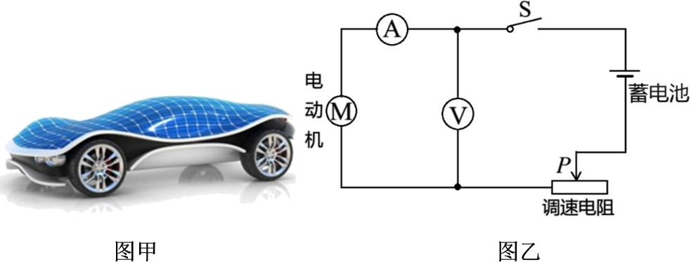

# Physics - 题目 688

**ID**: 5d82db1097454c4593a3db0a46919b41
**年级**: Grade 9
**难度**: Medium
**题型**: Calculation

## 题目
如图甲所示是人们研制的太阳能电动汽车，车辆顶部的太阳能电池板将光能转化为电能储存在蓄电池中，蓄电池再给汽车的电动机供电。​​​​​​​‌小亮设计的调节电动机转速的简化电路如图乙所示，若蓄电池的电压保持不变，调速电阻的最大阻值为100Ω。闭合开关S，当调速电阻的滑片滑到最左端时车速最大，此时电流表的示数为4A，电动机的电功率为1.2kW；当调速电阻的滑片P滑到最右端时车速最小，此时电压表的示数为120 V。求：（1）此蓄电池的电压多大？（2）车速最小时，电流表的示数多大？（3）该电动汽车以最小车速行驶10min，消耗的电能多大？

## 解答

1. 解：（1）当滑片P移至最左端时，调速电阻接入阻值为0，电路中只有电动机工作。由 $P=UI$ 得：此时电动机两端的电压 $U{{}_{机}}=\frac {P{{}_{大}}}{I{{}_{大}}}=\frac {1200{\rm{W}}}{4{\rm{A}}}=300{\rm{V}}$ ，蓄电池的电压 $U{{}_{电源}}=U{{}_{机}}=300{\rm{V}}$
2. （2）当P在最右端时，调速电阻的阻值 $R{{}_{调}}=R{{}_{大}}=100Ω$ ，电动机与调速电阻串联，电压表测电动机两端的电压 $U{{}_{机}}{^{\prime }}=U{{}_{电压表}}=120{\rm{V}}$ ，调速电阻两端电压 $U{{}_{调}}=U{{}_{电源}}-U{{}_{机}}{^{\prime }}=300{\rm{V}}-120{\rm{V}}=180{\rm{V}}$ ，调速电阻中的电流 $I{{}_{调}}=\frac {U{{}_{调}}}{R{{}_{调}}}=\frac {180{\rm{V}}}{100\Omega }=1.8{\rm{A}}$ ，车速最小时，电流表的示数 $I{{}_{小}}=I{{}_{调}}=1.8{\rm{A}}$
3. （3）由题意 $t=10{\rm{m}}{\rm{i}}{\rm{n}}=600{\rm{s}}$ ，该电动汽车以最小车速行驶10min，消耗的电能 $W=U{{}_{电源}}I{{}_{小}}t=300{\rm{V}}\times 1.8{\rm{A}}\times 600{\rm{s}}=3.24\times 10{^{5}}{\rm{J}}$
4. 答：（1）此蓄电池的电压为300V；
5. （2）车速最小时，电流表的示数为1.8A；
6. （3）该电动汽车以最小车速行驶10min，消耗的电能 $3.24\times 10{^{5}}{\rm{J}}$

## 知识点

**中文**:
  - 非纯电阻电路的相关计算

**English**:
  - Calculations for Non-Pure Resistive Circuits

---
