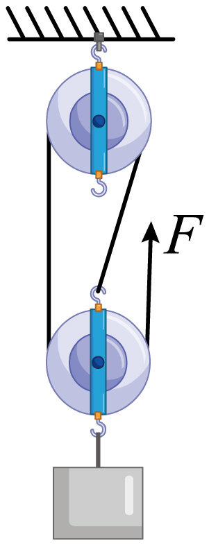

# Physics - 题目 490

**ID**: 61706fcf8595496d8715a4f3796b4521
**年级**: Grade 9
**难度**: Medium
**题型**: Calculation

## 题目
建筑工地上，某施工人员利用如图所示的滑轮组匀速提升重物。​​​​​​​‌若不计摩擦和绳重，利用这个滑轮匀速提升重为900N的物体时，所用的拉力是400N，求：（1）动滑轮的重力；（2）此时滑轮组的机械效率是多少；（3）当用这个滑轮组匀速提升重为1200N的物体时，拉力是多少。

## 解答

1. 解：（1）由图可知，绳子承重股数为n=3，不计摩擦和绳重，那么有
2. $F=\frac {1}{n}(G+G{{}_{动}})$
3. 动滑轮的重力为
4. $G{{}_{动}}=nF-G={\rm{3}}{\rm{×}}{\rm{4}}{\rm{0}}{\rm{0}}{\rm{N}}{\rm{-}}{\rm{9}}{\rm{0}}{\rm{0}}{\rm{N}}{\rm{=}}{\rm{3}}{\rm{0}}{\rm{0}}{\rm{N}}$
5. （2）滑轮组的机械效率为
6. $η{\rm{=}}\frac {W{{}_{有}}}{W{{}_{总}}}=\frac {Gh}{Fs}{\rm{=}}\frac {Gh}{Fnh}{\rm{=}}\frac {G}{nF}=\frac {{\rm{9}}{\rm{0}}{\rm{0}}{\rm{N}}}{{\rm{3}}{\rm{×}}{\rm{4}}{\rm{0}}{\rm{0}}{\rm{N}}}{\rm{×}}{\rm{1}}{\rm{0}}{\rm{0}}{\rm{\%}}{\rm{=}}{\rm{7}}{\rm{5}}{\rm{\%}}$
7. （3）不计摩擦和绳重，当用这个滑轮组匀速提升重为1200N的物体时，此时的拉力为
8. $F^{′}=\frac {1}{n}(G^{′}+G{{}_{动}})=\frac {{\rm{1}}}{{\rm{3}}}{\rm{×}}{\rm{(}}{\rm{1}}{\rm{2}}{\rm{0}}{\rm{0}}{\rm{N}}{\rm{+}}{\rm{3}}{\rm{0}}{\rm{0}}{\rm{N}}{\rm{)}}{\rm{=}}{\rm{5}}{\rm{0}}{\rm{0}}{\rm{N}}$
9. 答：（1）动滑轮的重力为300N；
10. （2）此时滑轮组的机械效率是75%；
11. （3）当用这个滑轮组匀速提升重为1200N的物体时，拉力是500N。

## 知识点

**中文**:
  - 滑轮组及其工作特点
  - 滑轮组绳子拉力的计算
  - 滑轮（组）的机械效率及其计算

**English**:
  - Pulley Systems and Operating Characteristics
  - Calculating Rope Tension in Pulley Systems
  - Mechanical Efficiency of Pulleys and Calculations

---
