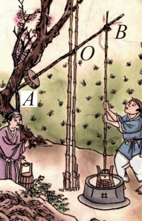

# Physics - 题目 462

**ID**: 6ca0ca36efa840589d01a0d707294876
**年级**: Grade 9
**难度**: Medium
**题型**: Calculation

## 题目
桔棒是《天工开物》中记载的一种汲水工具。​​​​​​​‌如图所示，将一根硬杆用细绳悬挂在树上，杆可绕O点自由旋转，用细绳将重为20N、容积为0.03m^{2}的木桶悬挂在B端，用细绳将重为120N的拗石悬挂在A端，在拗石辅助下，人可以将装满水的桶从井中提起，绳子始终保持在竖直方向上，OA：OB=3：2，忽略杆和绳的重力。求：（1）桶内装满水时，水的重力；（2）空木桶在井中水面漂浮时，木桶受到的浮力；（3）人用桔槔将装满水的桶提出水面后，当桔槔处于平衡状态时，人对绳子的拉力。

## 解答

1. 解：（1）桶装满水时水的质量 $m{{}_{水}}=ρ{{}_{水}}V={{1}}{{.}}{{0}}\times {{1}}{{0}}{^{{{3}}}}{\rm{k}}{\rm{g}}{\rm{/}}{\rm{m}}{^{{{3}}}}\times {{0}}{{.}}{{0}}{{3}}{\rm{m}}{^{{{3}}}}{\rm{=}}{{3}}{{0}}{\rm{k}}{\rm{g}}$ ，桶内装满水时水的重力 $G{{}_{水}}=m{{}_{水}}g={{3}}{{0}}{\rm{k}}{\rm{g}}\times {{1}}{{0}}{\rm{N}}{\rm{/}}{\rm{k}}{\rm{g}}{\rm{=}}{{3}}{{0}}{{0}}{\rm{N}}$ 。
2. （2）漂浮在水面时桶受到的浮力 $F{{}_{浮}}=G{{}_{桶}}=20{\rm{N}}$ 。
3. （3）桔棒平衡时，根据杠杆平衡条件可求，绳子对B端的拉力为 $F{{}_{B}}=\frac {F{{}_{A}}L{{}_{OA}}}{L{{}_{OB}}}=\frac {G{{}_{石}}L{{}_{OA}}}{L{{}_{OB}}}=\frac {{{1}}{{2}}{{0}}{\rm{N}}\times {{3}}}{{{2}}}{\rm{=}}{{1}}{{8}}{{0}}{\rm{N}}$ ，绳子对木桶的拉力 $F{{}_{绳}}=F{{}_{B}}={{1}}{{8}}{{0}}{\rm{N}}$ ，人对绳子的拉力 $F{{}_{拉}}=G{{}_{水}}+G{{}_{桶}}-F{{}_{绳}}{\rm{=}}300{\rm{N}}{{+}}20{\rm{N}}{{-}}180{\rm{N}}{\rm{=}}140{\rm{N}}$ 。
4. 答：（1）桶内装满水时，水的重力为300N；
5. （2）空木桶在井中水面漂浮时，木桶受到的浮力为20N；
6. （3）人用桔槔将装满水的桶提出水面后，当桔槔处于平衡状态时，人对绳子的拉力为140N。

## 知识点

**中文**:
  - 杠杆平衡条件的应用
  - 重力公式的应用
  - 物体的浮沉条件及其应用

**English**:
  - Application of Lever Equilibrium Conditions
  - Application of Gravity Formula
  - Floating/Sinking Conditions and Applications

---
