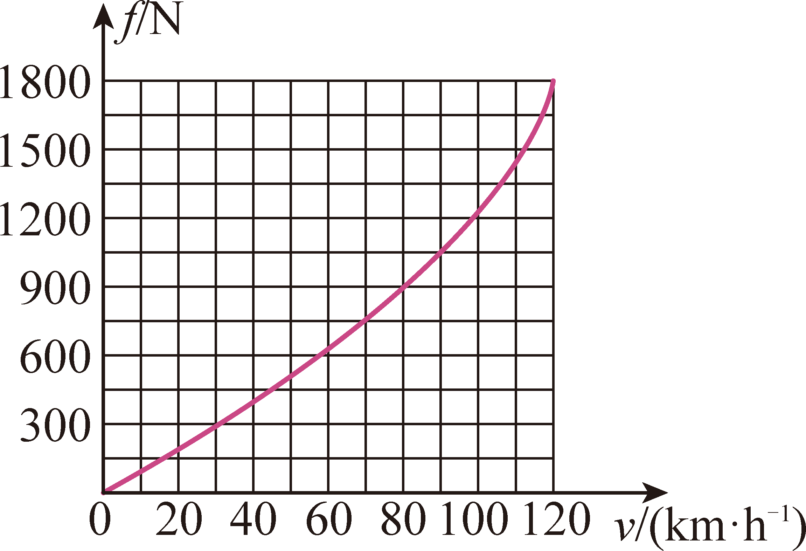

# Physics - 题目 2934

**ID**: 6fa0caf1bf434150b1580e55080c0544
**年级**: Grade 9
**难度**: Medium
**题型**: Calculation

## 题目
油电混合动力汽车是新型节能汽车。​​​​​​​‌这种汽车高速行驶时，内燃机启动，既向车轮输送能量也给动力蓄电池组充电。测试人员驾驶该车在平直公路上以80km/h的测试车速匀速行驶0.5h，内燃机消耗燃油2.5kg，汽车行驶时所受阻力f和车速v的关系如图所示。（燃油的热值为4.6×10^{7}J/kg）则：（1）该汽车测试行驶的路程是多少？（2）该汽车测试行驶中牵引力做了多少功？（3）若该汽车在测试过程中内燃机的效率为40%，此过程使蓄电池增加了多少能量？

## 解答

1. （1）由题意知，汽车行驶速度v=80km/h，行驶时间t=0.5h。根据速度公式 $v=\frac {s}{t}$ 可得，汽车行驶的路程为s=vt=80km/h×0.5h=40km
2. （2）因为汽车匀速行驶，所以它处于平衡状态，其牵引力与所受阻力大小相等。由图像可知，当车速v=80km/h时，汽车所受的阻力f=900N。因此，汽车的牵引力F=f=900N
3. 则牵引力做的功为W_{牵引}=Fs=900N×40×10^{3}m=3.6×10^{7}J
4. （3）燃油完全燃烧放出的总热量为Q_{放}=m_{燃油}q=2.5kg×4.6×10^{7}J/kg=1.15×10^{8}J
5. 内燃机产生的总有用功，即转化成的总机械能和电能为W_{总}=Q_{放}η=1.15×10^{8}J×40%=4.6×10^{7}J
6. 这部分总有用功分为两部分，一部分是驱动汽车行驶的功W_{牵引}，另一部分是给蓄电池充电的能量E_{蓄电池}。所以，此过程使蓄电池增加的能量为E_{蓄电池}=W_{总}-W_{牵引}=4.6×10^{7}J-3.6×10^{7}J=1.0×10^{7}J

## 知识点

**中文**:
  - 二力及多力平衡的判断和应用
  - 速度公式及其应用
  - 功的计算和估算
  - 热值及相关计算

**English**:
  - Judgment and Application of Equilibrium of Forces
  - Velocity Formula and Applications
  - Calculation and Estimation of Work
  - Calorific Value and Calculations

---
