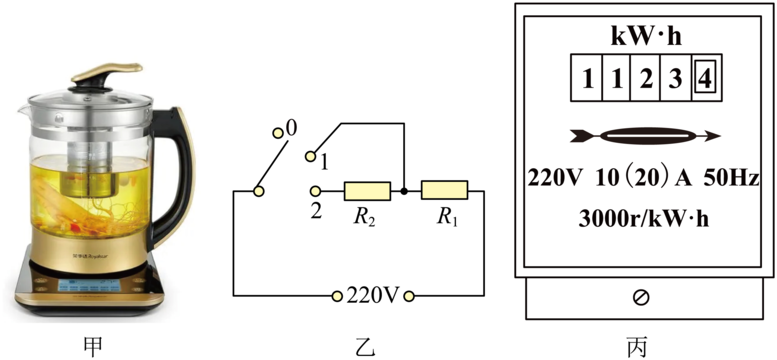

# Physics - 题目 1674

**ID**: 924119dd94cf4d6391942a24b2f1dc4e
**年级**: Grade 9
**难度**: Medium
**题型**: Calculation

## 题目
如图甲为一款养生壶，其加热原理如图乙所示。​​​​​​​‌养生壶的额定电压为220V， $R{{}_{{\rm{1}}}}、R{{}_{{\rm{2}}}}$ 均是发热电阻，其中 $R{{}_{2}}=506{\rm{Ω}}$ 。开关置于“1”时电路中电流为5A。求：（1）当开关置于“1”时， $R{{}_{{\rm{1}}}}$ 的阻值；（2）当开关置于“2”时，通电1min，养生壶消耗的电能；（3）将该养生壶接入家庭电路中单独工作，养生壶给水加热的过程中，观察到家里电能表（如图丙所示）的转盘120s内转了100转，则该养生壶消耗的电功率是？

## 解答

1. 解：（1）当开关置于“1”时，电流为5A，是只有R_{1}接入的简单电路，所以R_{1}的阻值为 $R{{}_{1}}=\frac {U}{I{{}_{1}}}=\frac {220{\rm{V}}}{5{\rm{A}}}=44{\rm{Ω}}$
2. （2）当开关置于“2”时，R_{1}与R_{2}串联，所以此时电路中的电流为 $I{{}_{总}}=\frac {U}{R{{}_{1}}+R{{}_{2}}}=\frac {220{\rm{V}}}{44{\rm{Ω}}+506{\rm{Ω}}}=0.4{\rm{A}}$ ，通电1min，养生壶消耗的电能为 $W=UIt=220{\rm{V}}\times 0.4{\rm{A}}\times 1\times 60{\rm{s}}=5280{\rm{J}}$
3. （3）转盘120s内转了100转，消耗的电能为 $W^{′}=\frac {100{\rm{r}}}{3000{\rm{r}}/\left ({{\rm kW}·{\rm{h}}}\right )}=\frac {1}{30}{\rm kW}·{\rm{h}}$ ，则该养生壶消耗的电功率是 $P=\frac {W^{′}}{t}=\frac {\frac {1}{30}{\rm kW}·{\rm{h}}}{\frac {120}{3600}{\rm{h}}}=1{\rm kW}$
4. 答：（1）R_{1}的阻值为44Ω；
5. （2）通电1min，养生壶消耗的电能为5280J；
6. （3）该养生壶消耗的电功率是1kW。

## 知识点

**中文**:
  - 与欧姆定律有关的动态电路计算
  - 电能表的读数及电能的求解
  - 电功率的计算及应用

**English**:
  - Calculations in Dynamic Circuits using Ohm's Law
  - Reading Energy Meters and Calculating Energy
  - Calculation and Application of Electric Power

---
