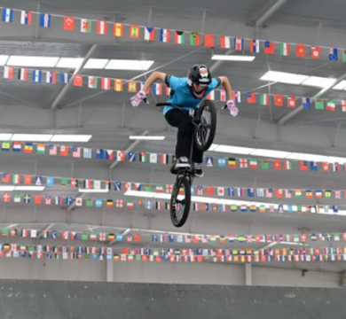

# Physics - 题目 1120

**ID**: 998551c3837f49ef9b1c043d555a9a93
**年级**: Grade 9
**难度**: Medium
**题型**: Calculation

## 题目
在2025年4月举办的中国自由式小轮车联赛第一站比赛中，运动员黄江在比赛过程中展现出了高超的技巧。​​​​​​​‌已知黄江和他的小轮车总质量为 $60{\rm{k}}{\rm{g}}$ ，在某一水平骑行阶段，小轮车每个轮胎与地面的接触面积为 $50{\rm{c}}{\rm{m}}{^{2}}$ ，黄江在 $10{\rm{s}}$ 内沿直线骑行通过了 $100{\rm{m}}$ 的距离；在后续的一个跳跃动作中，他和小轮车克服重力做功450J。求：（1）黄江在水平骑行阶段的平均速度是多少 ${\rm{k}}{\rm{m}}/{\rm{h}}$ ？（2）黄江在水平骑行阶段小轮车对地面的压强是多少Pa？（3）黄江跳跃时上升的高度是多少 ${\rm{m}}$ ？

## 解答

1. （1）平均速度等于总路程与总时间之比，黄江在水平骑行阶段的平均速度是 $v=\frac {s}{t}=\frac {{{1}}{{0}}{{0}}{\rm{m}}}{{{1}}{{0}}{\rm{s}}}{\rm{=}}{{1}}{{0}}{\rm{m}}{\rm{/}}{\rm{s}}{\rm{=}}{{1}}{{0}}\times {{3}}{{.}}{{6}}{\rm{k}}{\rm{m}}{\rm{/}}{\rm{h}}{\rm{=}}{{3}}{{6}}{\rm{k}}{\rm{m}}{\rm{/}}{\rm{h}}$
2. （2）小轮车在骑行时双轮着地，因此受力面积为 $S=2\times 50{\rm{c}}{\rm{m}}{^{{{2}}}}{\rm{=}}{{2}}\times {{5}}{{0}}\times {{1}}{{0}}{^{{{-}}{{4}}}}{\rm{m}}{^{{{2}}}}{\rm{=}}{{1}}{{0}}{^{{{-}}{{2}}}}{\rm{m}}{^{{{2}}}}$
3. 小轮车对地面的压力大小等于人和小轮车的总重力 $F=G=mg=60{\rm{k}}{\rm{g}}\times {{1}}{{0}}{\rm{N}}{\rm{/}}{\rm{k}}{\rm{g}}{\rm{=}}{{6}}{{0}}{{0}}{\rm{N}}$
4. 对地面的压强为 $p=\frac {F}{S}=\frac {G}{S}=\frac {{{6}}{{0}}{{0}}{\rm{N}}}{{{1}}{{0}}{^{{{-}}{{2}}}}{\rm{m}}{^{{{2}}}}}{\rm{=}}{{6}}\times {{1}}{{0}}{^{{{4}}}}{\rm{P}}{\rm{a}}$
5. （3）上升时，克服重力所做的功是克服人和小轮车总重所做的功，故人和小轮车上升的高度为 $h=\frac {W}{G}=\frac {{{4}}{{5}}{{0}}{\rm{J}}}{{{6}}{{0}}{{0}}{\rm{N}}}{\rm{=}}{{0}}{{.}}{{7}}{{5}}{\rm{m}}$

## 知识点

**中文**:
  - 功的计算和估算
  - 平均速度及其计算
  - 压强的计算

**English**:
  - Calculation and Estimation of Work
  - Average Velocity and Calculation
  - Calculation of Pressure

---
