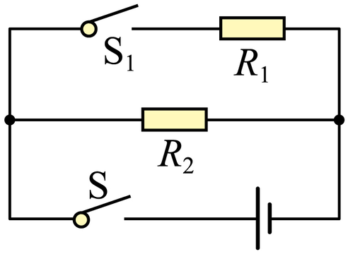

# Physics - 题目 1133

**ID**: 9ba8aec659514752a4252213dd5d43a8
**年级**: Grade 9
**难度**: Medium
**题型**: Calculation

## 题目
某款鸡蛋孵化器的底部装有加热器，通电后，加热器对水加热，水向上方鸡蛋传递热量，提供孵化所需能量。​​​​​​​‌孵化器简化电路如图所示， $R{{}_{1}}、R{{}_{2}}$ 都是阻值不变的发热电阻，孵化器相关参数如表所示。求：额定电压220V额定功率加热挡80W保温挡22W（1）孵化器在保温挡正常工作时，通过 $R{{}_{2}}$ 的电流是多大？ $R{{}_{2}}$ 的阻值是多大？（2）孵化器在加热挡正常工作时 $R{{}_{1}}$ 的功率是多大？（3）孵化器在加热挡正常工作5min消耗的电能是多大？若水在这段时间内吸收的热量为 $2.16\times 10{^{4}}{\rm{J}}$ ，则孵化器对水加热的效率是多大？

## 解答

1. （1）分析电路图可知，当S闭合，S_{1}断开时，R_{2}单独工作，为保温挡；当S与S_{1}均闭合时，R_{1}与R_{2}并联工作，为加热挡。保温挡正常工作时，通过R_{2}的电流为
2. $I{{}_{2}}=\frac {P{{}_{保}}}{U}=\frac {22{\rm{W}}}{220{\rm{V}}}=0.1{\rm{A}}{\rm \mathit{R}_{2}}$ 的阻值为
3. $R{{}_{2}}=\frac {U}{I{{}_{2}}}=\frac {220{\rm{V}}}{0.1{\rm{A}}}=2200{\rm{Ω}}$
4. （2）在加热挡正常工作时，R_{1}与R_{2}并联，此时R_{2}两端电压与保温挡工作时R_{2}两端的电压相同，功率相同，为22W。加热挡总功率为80W，所以在加热挡正常工作时，R_{1}的功率为
5. $P{{}_{1}}=P{{}_{加}}-P{{}_{保}}=80{\rm{W}}-22{\rm{W}}=58{\rm{W}}$
6. （3）孵化器在加热挡正常工作5min消耗的电能是
7. W=P_{加}t=80W×5×60s=2.4×10^{4}J
8. 孵化器对水加热的效率是
9. $η=\frac {Q}{W}=\frac {2.16\times 10{^{4}}{\rm{J}}}{2.4\times 10{^{4}}{\rm{J}}}=90\%$

## 知识点

**中文**:
  - 电与热综合计算

**English**:
  - Comprehensive Calculation of Electricity and Heat

---
