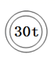

# Physics - 题目 817

**ID**: a0706db5d33a481e853c08a1c8c71525
**年级**: Grade 9
**难度**: Medium
**题型**: Calculation

## 题目
车辆超载容易导致交通事故，现有一辆重型卡车自重为 $1.7\times 10{^{5}}{\rm{N}}$ ，车厢容积为 $12{\rm{m}}{^{3}}$ 。​​​​​​​‌若该车装满沙子，行驶到一座大桥前，看到桥梁旁竖着一块标志牌（如图所示），（g=10N/kg，沙子密度 $ρ=1.5\times 10{^{3}}{\rm{k}}{\rm{g}}{\rm{/}}{\rm{m}}{^{{\rm{3}}}}$ ）。求：（1）这车沙子的质量为多少 ${\rm{t}}$ ？（2）该车能否通过此桥？

## 解答

1. (1)由 $ρ=\frac {m}{V}$ 得，沙子的质量是
2. $m{{}_{沙}}=ρV=1.5\times 10{^{{\rm{3}}}}{\rm{k}}{\rm{g}}{\rm{/}}{\rm{m}}{^{3}}\times 12{\rm{m}}{^{3}}=1.8\times 10{^{4}}{\rm{k}}{\rm{g}}=1{\rm{8}}{\rm{t}}$
3. (2)由 $G=mg$ 得，车的质量
4. $m{{}_{车}}=\frac {G}{g}=\frac {1.7\times 10{^{5}}{\rm{N}}}{10{\rm{N}}{\rm{/}}{\rm{k}}{\rm{g}}}=1.7\times 10{^{4}}{\rm{k}}{\rm{g}}==17{\rm{t}}$
5. 由图知，大桥能够承受的最大质量为 $30{\rm{t}}$ ，卡车的总质量
6. $m{{}_{总}}=m{{}_{车}}+m{{}_{沙}}=17{\rm{t}}+18{\rm{t}}=35{\rm{t}}$
7. 由于 $35{\rm{t}}>3{\rm{0}}{\rm{t}}$ ，所以该车不能通过此桥。
8. 答：(1)这车沙子的质量为18t；
9. (2)该车不能通过此桥。

## 知识点

**中文**:
  - 密度公式的应用

**English**:
  - Application of Density Formula

---
