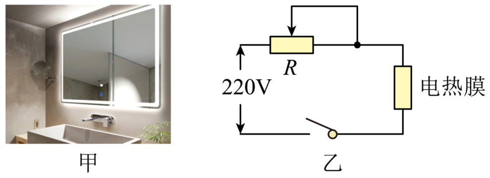

# Physics - 题目 2627

**ID**: a731ed376f7449bdb6e73386f66b0101
**年级**: Grade 9
**难度**: Medium
**题型**: Calculation

## 题目
图甲所示是某型号的浴室防雾镜，其背面粘贴有等大的电热膜，使用时镜面受热，水蒸气无法凝结其上，便于成像，该防雾镜的相关数据如表：镜子质量1.2kg额定电压220V额定功率88W（1）求防雾镜正常工作时的电流；（2）经测试，在﹣5℃环境下工作500s使平面镜的平均温度升高了44℃，求电热膜给平面镜的加热效率；[玻璃的比热容为0.75×10^{3}J/(kg•℃)]（3）如图乙所示，小明给防雾镜电路连接了一个滑动变阻器R，能使电热膜的功率在原功率的25%～100%之间变化，以满足不同季节使用的需要，请求出R的最大阻值。​​​​​​​‌

## 解答

1. 解：（1）由P=UI可得，防雾镜正常工作时的电流
2. $I=\frac {P}{U}=\frac {{\rm{8}}{\rm{8}}{\rm{W}}}{{\rm{2}}{\rm{2}}{\rm{0}}{\rm{V}}}=0.4{\rm{A}}$
3. （2）正常工作500s，平面镜吸收的热量
4. Q_{吸}=c_{玻璃}m△t_{升}=0.75×10^{3}J/(kg•℃)×1.2kg×44℃=3.96×10^{4}J
5. 正常工作500s，电热膜产生的热量
6. Q=W=Pt=88W×500s═4.4×10^{4}J
7. 加热效率
8. η= $\frac {Q{{}_{吸}}}{Q}$ ×100%= $\frac {3.96\times 10{^{4}}{\rm{J}}}{4.4\times 10{^{4}}{\rm{J}}}$ ×100%=90%
9. （3）由P= $\frac {U{^{2}}}{R}$ 可得，电热膜的电阻
10. R_{0}= $\frac {U{^{2}}}{P}=\frac {{\left({220{\rm{V}}}\right)^{2}}}{88{\rm{W}}}$ =550Ω
11. 当变阻器R的阻值最大时，通过电热膜的电流最小，此时电热膜的功率最小，结合题意可知，电热膜的最小功率为
12. P_{最小}=88W×25%=22W
13. 由P=I^{2}R可得，此时通过它的电流
14. I_{小}= $\sqrt {\frac {P{{}_{最小}}}{R{{}_{0}}}}=\sqrt {\frac {22{\rm{W}}}{550Ω}}$ =0.2A
15. 由欧姆定律可得，此时电路中的总电阻
16. R_{总}= $\frac {U}{I{{}_{小}}}=\frac {220{\rm{V}}}{0.2{\rm{A}}}$ =1100Ω
17. 则变阻器的最大阻值
18. R=R_{总}﹣R_{0}=1100Ω﹣550Ω=550Ω
19. 答：（1）防雾镜正常工作时的电流为0.4A；
20. （2）电热膜给平面镜的加热效率为90%；
21. （3）R的最大阻值为550Ω。

## 知识点

**中文**:
  - 电与热综合计算

**English**:
  - Comprehensive Calculation of Electricity and Heat

---
