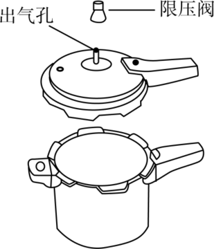

# Physics - 题目 1741

**ID**: aa609ccdb3fa4c008eb5734d1dce3a73
**年级**: Grade 9
**难度**: Medium
**题型**: Calculation

## 题目
高压锅是生活中一种密闭的加热容器。​​​​​​​‌锅盖中央有一个出气孔，孔上盖有限压阀，当锅内气压达到限定值时，限压阀被锅内气体顶起放出部分气体，实现对锅内气体的控制。如图所示，某型号高压锅出气孔面积为8×10^{-6}m^{2}，用此高压锅煮饭时，要使锅内的气压达到2个标准大气压，请你计算该高压锅应配的限压阀质量为多少千克？（已知外界气压为1个标准大气压，1个标准大气压取10^{5}Pa，g取10N/kg）

## 解答

1. 设出气口的面积为S，外界大气压为 $p{{}_{0}}$ ，锅内气压为p，限压阀质量为m，依题意可知pS=p_{0}S+mg，$m=\frac {\left ({p-p{{}_{0}}}\right )S}{g}$ ， $m=\frac {\left ({2\times 10{^{5}}{\rm{P}}{\rm{a}}-1\times 10{^{5}}{\rm{P}}{\rm{a}}}\right )\times 8\times 10{^{-6}}{\rm{m}}{^{2}}}{10{\rm{N}}/{\rm{k}}{\rm{g}}}=0.08{\rm{k}}{\rm{g}}$ 。
2. 答：该高压锅应配的限压阀质量为0.08kg。

## 知识点

**中文**:
  - 压强的计算
  - 重力公式的应用

**English**:
  - Calculation of Pressure
  - Application of Gravity Formula

---
