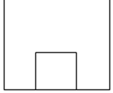

# Physics - 题目 380

**ID**: d1d0b6f93b1c4ffd862877a058f82723
**年级**: Grade 9
**难度**: Medium
**题型**: Calculation

## 题目
如图所示，水平桌面上有一个高为30cm的柱形容器，现将一个圆柱形金属块（重120N、高20cm、底面积100cm^{2}）置于柱形容器底部。​​​​​​​‌取g=10N/kg。（1）计算图中金属块对容器底部的压强。（2）若向图中容器内加水，当水深20cm时，金属块受到的浮力是多少牛？

## 解答

1. 解：（1）金属块重120N，底面积 $100{\rm{c}}{\rm{m}}{^{2}}$ ，金属块对容器底部的压力等于其重力为 $F=G=120{\rm{N}}$ ，甲图中金属块对容器底部的压强 $p=\frac {F}{S{{}_{金}}}{\rm{=}}\frac {{{1}}{{2}}{{0}}{\rm{N}}}{100\times 10{^{{{-}}4}}{\rm{m}}{^{2}}}=1.2\times 10{^{4}}{\rm{P}}{\rm{a}}$ 。
2. （2）金属块的体积 $V=S{{}_{金}}h{\rm{=}}100{\rm{c}}{\rm{m}}{^{2}}\times 20{\rm{c}}{\rm{m}}{\rm{=}}{{2}}{{0}}{{0}}{{0}}{\rm{c}}{\rm{m}}{^{3}}=2\times 10{^{-3}}{\rm{m}}{^{3}}$ ，根据 $G=mg=ρVg$ 可得金属块的密度为 $ρ{{}_{金}}{\rm{=}}\frac {G}{Vg}=\frac {{{1}}{{2}}{{0}}{\rm{N}}}{{{1}}{{0}}{\rm{N}}{\rm{/}}{\rm{k}}{\rm{g}}\times 2\times 10{^{-3}}{\rm{m}}{^{3}}}=6\times 10{^{3}}{\rm{k}}{\rm{g}}{\rm{/}}{\rm{m}}{^{3}}>1\times 10{^{3}}{\rm{k}}{\rm{g}}{\rm{/}}{\rm{m}}{^{3}}$ ，所以，若向甲图中容器内加水，金属块沉底；当水深20cm时，因圆柱形金属块的高度为20cm，所以，金属块刚好浸没，则 $V{{}_{排}}{\rm{=}}V=S{{}_{金}}h{\rm{=}}100{\rm{c}}{\rm{m}}{^{2}}\times 20{\rm{c}}{\rm{m}}{\rm{=}}{{2}}{{0}}{{0}}{{0}}{\rm{c}}{\rm{m}}{^{3}}=2\times 10{^{-3}}{\rm{m}}{^{3}}$ ，由阿基米德原理求出受到的浮力为 $F{{}_{浮}}=ρ{{}_{液}}Vg{\rm{=}}1\times 10{^{3}}{\rm{k}}{\rm{g}}{\rm{/}}{\rm{m}}{^{3}}\times 2\times 10{^{-3}}{\rm{m}}{^{3}}\times {{1}}{{0}}{\rm{N}}{\rm{/}}{\rm{k}}{\rm{g}}{\rm{=}}20{\rm{N}}$ 。
3. 答：（      ）图中金属块对容器底部的压强为 $1.2\times 10{^{4}}{\rm{P}}{\rm{a}}$ ；
4. （2）若向图中容器内加水，当水深20cm时，金属块受到的浮力是20N。

## 知识点

**中文**:
  - 压强的计算
  - 密度公式的应用
  - 阿基米德原理的应用

**English**:
  - Calculation of Pressure
  - Application of Density Formula
  - Applications of Archimedes' Principle

---
