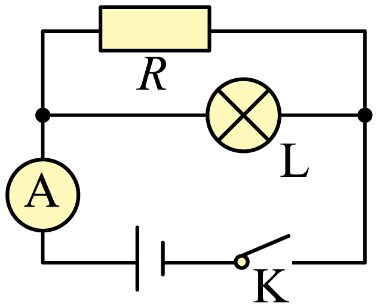

# Physics - 题目 897

**ID**: e02cbd9795414f689aace681d145bac3
**年级**: Grade 9
**难度**: Medium
**题型**: Calculation

## 题目
如图所示，R为定值电阻，L为标有“6V　3W”的小灯泡，灯丝阻值不变，电源电压恒定。​​​​​​​‌闭合开关，小灯泡正常工作时，电流表读数为0.9A。求：（1）通过小灯泡的电流，以及小灯泡电阻；（2）定值电阻R阻值，以及它的电功率。

## 解答

1. 解：由电路图可知，R与L并联，电流表测量干路中的电流。
2. （1）灯泡正常发光时，灯两端的实际电压等于其额定电压，即 $U{{}_{{\rm{L}}}}=U{{}_{额}}=6{\rm{V}}$ ，实际功率等于其额定功率，即 $P{{}_{{\rm{L}}}}=P{{}_{额}}=3{\rm{W}}$ ，灯泡的电流为 $I{{}_{{\rm{L}}}}=\frac {P{{}_{{\rm{L}}}}}{U{{}_{{\rm{L}}}}}=\frac {3{\rm{W}}}{6{\rm{V}}}=0.5{\rm{A}}$ ，小灯泡电阻为 $R{{}_{{\rm{L}}}}{\rm{=}}\frac {U{{}_{{\rm{L}}}}}{I{{}_{{\rm{L}}}}}{\rm{=}}\frac {{{6}}{\rm{V}}}{{{0}}{{.}}{{5}}{\rm{A}}}{\rm{=}}{{1}}{{2}}{\rm{Ω}}$ 。
3. （2）根据并联电路的电流规律可知，通过R的电流为 $I^{′}{{\rm{=}}}I-I{{}_{{\rm{L}}}}{\rm{=}}{{0}}{{.}}{{9}}{\rm{A}}{{-}}{{0}}{{.}}{{5}}{\rm{A}}{\rm{\;}}{\rm{=}}{\rm{\;}}{{0}}{{.}}{{4}}{\rm{A}}$ ，根据并联电路的电压规律可知，R两端的电压为 $U{{}_{R}}{\rm{=}}U{{}_{{\rm{L}}}}{\rm{=}}{{6}}{\rm{V}}$ ，R的阻值为 $R{\rm{=}}\frac {U}{I^{′}}{\rm{=}}\frac {{{6}}{\rm{V}}}{{{0}}{{.}}{{4}}{\rm{A}}}{\rm{=}}{{1}}{{5}}{\rm{Ω}}$ ，R的功率为 $P^{′}{{\rm{=}}}UI^{′}{{\rm{=}}}{\rm{\;}}{{6}}{\rm{V}}\times {{0}}{{.}}{{4}}{\rm{A}}{\rm{\;}}{\rm{=}}{{2}}{{.}}{{4}}{\rm{W}}$ 。
4. 答：（1） 通过小灯泡的电流为 $0.5{\rm{A}}$ ；小灯泡电阻为 $12Ω$ 。
5. （2）定值电阻R阻值为 $15Ω$ ；它的电功率为 $2.4{\rm{W}}$ 。

## 知识点

**中文**:
  - 并联电路的电压规律
  - 并联电路的电流规律
  - 欧姆定律的应用
  - 电功率的计算及应用

**English**:
  - Voltage Law in Parallel Circuits
  - Current Law in Parallel Circuits
  - Applications of Ohm's Law
  - Calculation and Application of Electric Power

---
