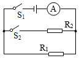

# Physics - 题目 1522

**ID**: e56595936e4d466ca3778e8414484a8e
**年级**: Grade 9
**难度**: Medium
**题型**: Calculation

## 题目
如图所示，电源电压为6V且保持不变，R_{2}=30Ω。​​​​​​​‌当只闭合开关S_{1}时，电流表A的示数是0.3A。求：(1)R_{1}电阻的大小。(2)S_{1}，S_{2}同时闭合时电流表变化的示数是多少A？(3)S_{1}，S_{2}同时闭合时，通电1min，R_{1}消耗的电能是多少？

## 解答

1. (1)当只闭合开关S_{1}时，电路中只有R_{1}，R_{1}的阻值为
2. $R{{}_{1}}=\frac {U}{I{{}_{1}}}=\frac {{\rm{6}}{\rm{V}}}{0.3{\rm{A}}}=20Ω$
3. (2)再开关S闭合时，两电阻并联，电流表测量干路中的电流，电流表的示数
4. $I=I{{}_{1}}+I{{}_{2}}=\frac {U}{R{{}_{1}}}{\rm{+}}\frac {U}{R{{}_{2}}}{\rm{=}}\frac {{\rm{6}}{\rm{V}}}{20{\rm{Ω}}}+\frac {{\rm{6}}{\rm{V}}}{30{\rm{Ω}}}=0.3{\rm{A}}{\rm{+}}{\rm{0}}{\rm{.}}{\rm{2}}{\rm{A}}{\rm{=}}{\rm{0}}{\rm{.}}{\rm{5}}{\rm{A}}$
5. 电流表的变化
6. $ΔI=0.5{\rm{A}}{\rm{-}}{\rm{0}}{\rm{.}}{\rm{3}}{\rm{A}}{\rm{=}}{\rm{0}}{\rm{.}}{\rm{2}}{\rm{A}}$
7. (3)S_{1}，S_{2}同时闭合时，通过R_{1}的电流为0.3A，所以R_{1}消耗的电能为
8. W_{1}=UI_{1}t=6V×0.3A×60s=108J
9. 答：(1)R_{1}电阻的大小是20Ω；
10. (2)S_{1}，S_{2}同时闭合时电流表变化的示数是0.2A；
11. (3)S_{1}，S_{2}同时闭合时，通电1min，R_{1}消耗的电能是108J。

## 知识点

**中文**:
  - 并联电路的电流规律
  - 欧姆定律的应用
  - 电功与电能的计算

**English**:
  - Current Law in Parallel Circuits
  - Applications of Ohm's Law
  - Calculation of Electric Work and Energy

---
