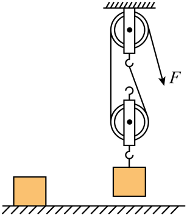

# Physics - 题目 1722

**ID**: ea95c1f247da4c8fa24af8d0f81a33e6
**年级**: Grade 9
**难度**: Medium
**题型**: Calculation

## 题目
如图所示，一个边长为0.1m的正方体质量为9kg，放在水平地面上，已知动滑轮的重力为6N，不计摩擦和绳重，用如图所示的滑轮组将正方体竖直向上匀速提升20cm。​​​​​​​‌ $g$ 取10N/kg。求：（1）该正方体平放在水平地面上时，对地面的压强为多大?（2）求拉力F所做的功？（3）该轮组机械效率是多少?

## 解答

1. 解：（1）该正方体平放在水平地面上时，对地面的压强为 $p=\frac {F}{S}=\frac {G}{S}=\frac {mg}{S}=\frac {9{\rm{k}}{\rm{g}}\times 10Ν/{\rm{k}}{\rm{g}}}{0.1{\rm{m}}\times 0.1{\rm{m}}}=9\times 10{^{3}}{\rm{P}}{\rm{a}}$ 。
2. （2）拉力F大小为 $F=\frac {1}{n}(G{{}_{物}}+G{{}_{动}})=\frac {1}{2}（9{\rm{k}}{\rm{g}}\times 10Ν/{\rm{k}}{\rm{g}}+6Ν）=48Ν$ ，绳子自由端移动的距离为 $s=nh=2\times 20{\rm{c}}{\rm{m}}{\rm{=}}{{4}}{{0}}{\rm{c}}{\rm{m}}{\rm{=}}{{0}}{{.}}{{4}}{\rm{m}}$ ，拉力F所做的功为 $W=Fs=48Ν\times 0.4{\rm{m}}=19.2{\rm{J}}$ 。
3. （3）该轮组机械效率是 $η=\frac {G{{}_{物}}}{G{{}_{物}}+G{{}_{动}}}=\frac {9{\rm{k}}{\rm{g}}\times 10Ν/{\rm{k}}{\rm{g}}}{9{\rm{k}}{\rm{g}}\times 10Ν/{\rm{k}}{\rm{g}}+6Ν}=93.75\%$ 。
4. 答：（1）该正方体平放在水平地面上时，对地面的压强为9000Pa；
5. （2）求拉力F所做的功 $19.2{\rm{J}}$ ；
6. （3）该轮组机械效率是93.75%。

## 知识点

**中文**:
  - 功的计算和估算
  - 压强的计算
  - 滑轮（组）的机械效率及其计算

**English**:
  - Calculation and Estimation of Work
  - Calculation of Pressure
  - Mechanical Efficiency of Pulleys and Calculations

---
