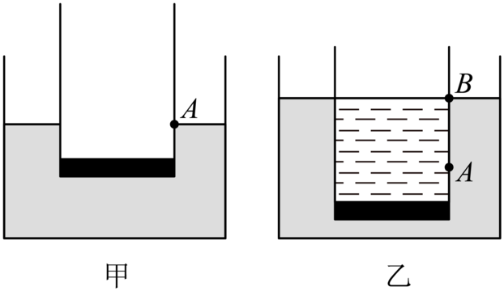

# Physics - 题目 2465

**ID**: f28aa3f1283443859f6f70068dba8603
**年级**: Grade 9
**难度**: Medium
**题型**: Calculation

## 题目
小明找来了一个透明水槽、一把刻度尺和一个柱状薄壁厚底杯测量食用油的密度。​​​​​​​‌如图甲，他先将杯子放在水槽中使其漂浮在水中，此时在杯子上标记水面的位置A；之后往杯中缓慢倒入食用油，直至油面与水面相平，如乙图所示，此时在杯子上标记水面的位置B；最后取出杯子，用刻度尺测出杯底厚度d=1.00cm，A、B到杯子最底端的距离分别为h_{A}=3.00cm、h_{B}=26.00cm，g取10N/kg，ρ_{水}=1.0×10^{3}kg/m^{3}（1）倒入食用油的过程中，杯子受到的浮力变，水对水槽底部的压强变；（2）乙图中，杯底所受水的压强为多少?（3）求食用油的密度。

## 解答

1. （1）倒入食用油的过程中，杯子排开水的体积增加，根据 $F{{}_{浮}}=ρ{{}_{液}}gV{{}_{排}}$ 可知，杯子受到的浮力变大。
2. 水槽底部进入水的深度变大，根据 $p=ρgh$ 可知，水对水槽底部的压强变大。
3. （2）乙图中杯底所处的深度为26.00cm，则杯底所受水的压强为 $p=ρgh=1.0\times 10{^{3}}kg/{\rm{m}}{^{3}}\times 10{\rm{N}}/kg\times 26\times 10{^{-2}}{\rm{m}}=2.6\times 10{^{3}}Pa$
4. （3）甲图中杯子漂浮，杯子受到的浮力与杯子的总重力相等，则杯子的重力为 $G=F{{}_{浮}}=ρ{{}_{液}}gV{{}_{排}}=ρ{{}_{水}}gSh{{}_{{\rm{A}}}}$
5. 乙图中杯子漂浮受到的浮力等于杯子和食用油的总重力，则总重力为 $G{{}_{总}}=F{{}_{浮}}{^{^{′}}}=ρ{{}_{液}}gV{{}_{排}}{^{^{′}}}=ρ{{}_{水}}gSh{{}_{{\rm{B}}}}$
6. 可得食用油的总重力为 $G{{}_{油}}=G{{}_{总}}-G=ρ{{}_{水}}gSh{{}_{{\rm{B}}}}-ρ{{}_{水}}gSh{{}_{{\rm{A}}}}=ρ{{}_{水}}gS\left ({h{{}_{{\rm{B}}}}-h{{}_{{\rm{A}}}}}\right )$
7. 油的体积为 $V{{}_{油}}=Sh{{}_{油}}=S\left ({h{{}_{{\rm{B}}}}-d}\right )$
8. 则食用油的密度为 $ρ{{}_{油}}=\frac {m{{}_{油}}}{V{{}_{油}}}=\frac {G{{}_{油}}}{gV{{}_{油}}}=\frac {ρ{{}_{水}}gS\left ({h{{}_{{\rm{B}}}}-h{{}_{{\rm{A}}}}}\right )}{gS\left ({h{{}_{{\rm{B}}}}-d}\right )}=ρ{{}_{水}}\times \frac {\left ({h{{}_{{\rm{B}}}}-h{{}_{{\rm{A}}}}}\right )}{\left ({h{{}_{{\rm{B}}}}-d}\right )}=1.0\times 10{^{3}}kg/{\rm{m}}{^{3}}\times \frac {\left ({26-3}\right )\times 10{^{-2}}{\rm{m}}}{\left ({26-1}\right )\times 10{^{-2}}{\rm{m}}}=0.92\times 10{^{3}}kg/{\rm{m}}{^{3}}$

## 知识点

**中文**:
  - 密度、压强和浮力的综合

**English**:
  - Integrated Density, Pressure, and Buoyancy

---
