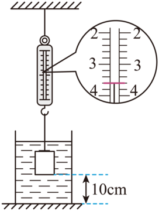

# Physics - 题目 1142

**ID**: f881416172b44048999f99205a2d5727
**年级**: Grade 9
**难度**: Medium
**题型**: Calculation

## 题目
如图，质量为0.46kg的物体浸没在水中静止时，下底面与容器底距离为10cm。​​​​​​​‌g取10N/kg，通过计算回答：（1）物体的重力是多少？（2）物体此时受到的浮力是多少？（3）物体的密度是多少？（4）剪断悬挂物体的细绳后，物体缓慢沉底，这个过程中合力对物体做功是多少？

## 解答

1. （1）物体的重力G=mg=0.46kg×10N/kg= 4.6N
2. （2）由图可知弹簧测力计的分度值是0.02N，示数是3.6N，物体受到的浮力F_{浮}=G-F=4.6N-3.6N=1N
3. （3）物体的体积 $V=V{{}_{排}}=\frac {F{{}_{浮}}}{ρ{{}_{水}}g}=\frac {1{\rm{N}}}{1\times 10{^{3}}kg/{\rm{m}}{^{3}}\times 10{\rm{N}}/kg}=1\times 10{^{-4}}{\rm{m}}{^{3}}$
4. 物体的密度 $ρ=\frac {m}{V}=\frac {0.46{\rm{k}}{\rm{g}}}{1\times 10{^{-4}}{\rm{m}}{^{2}}}=4.6\times 10{^{3}}{\rm{k}}{\rm{g}}{\rm{/}}{\rm{m}}{^{3}}$
5. （4）剪断悬挂物体的细绳后，物体受到的合力F_{合}=G-F_{浮}=4.6N-1N=3.6N
6. 这个过程中合力对物体做功W=F_{合}s=3.6N×10×0.01m=0.36J

## 知识点

**中文**:
  - 力的合成与应用
  - 重力公式的应用
  - 阿基米德原理的应用
  - 功的计算和估算

**English**:
  - Composition of Forces and Applications
  - Application of Gravity Formula
  - Applications of Archimedes' Principle
  - Calculation and Estimation of Work

---
