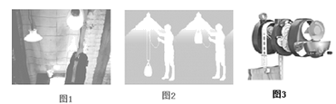

# Physics - 题目 195

**ID**: 09eaf4308fbc4b8ba318dd622c5d952c
**年级**: Grade 9
**难度**: Medium
**题型**: Comprehensive

## 题目
读短文,回答问题：贫民窟中的黑科技   单靠重力工作的电灯当我们在受电灯带来的各种便利时,身处在发展中国家贫困地区的人们却在依靠极度危险的煤油灯进行照明．针对发展中国家普遍用不上电的情况,2012年12月,英国伦敦设计师马丁瑞德福和吉姆里弗斯发明了一款实用的“重力灯”( Gravity Light),顾名思义,它靠重力发电,在灯身上挂着的一重物,重物下落时,它会拉动灯中心的一根绳子,从而启动一台发电机,发电机把下落重物产生的能量为灯供电．这和手摇式发电装置的原理一样,只不过重力灯的运动方向更垂直,这种重力灯和苹果手机一起被为21世纪最伟大的发明现在，重力灯迎来了第三代“重力LED灯GL02”,其亮度相当于一个12瓦的日光灯(如图甲),使用寿命可以达到200年．“重力LED灯GL02”挂于大约2米高,通过拉几下珠绳把重物吊起,松开后,重物因重力的关系会慢慢下降(每秒大约2mm,如图乙),重力灯的内部结构如图丙所示,以一系列的齿轮带动一个直流发电机,发电时间约为20分钟．“重力LED灯GL02”采用了全新的保护机制,可以确保超重的物体安全地着陆地面,当沙包落到地面时,只要将沙包再提离至原来位置,又可以继续发电,这样就能拥有绿色、不用电池,无污染、使用“零”成本、源源不断的光线,而且“重力LED灯GL02”机身上有DC插座,还可以为收音机等设备进行供电,其他类似的装置——比如电池充电器也能用同样的方式工作·重力LFD灯的照明时间取决于安装的高度,正常情况下,实于1.​​​​​​​‌8米的高度,可以维持约20分钟的照明,当然你实装高度的越高,维持时间越长．（1）重力灯的主要构件是直流发电机,它的工作原理是（2）重力灯工作过中主要的能量转化形式是：将能转化成能再转化成光能．（3）如果某一次使用重力灯,将质量为20kg的重物吊起到1.8m的高度释放,重物以2mm/s速度匀速竖直下降,整个过程中可使10只并联的标有3V 10mALED灯正常发光．则整个过程中重物的重力做功J(g=10N/kg);重力灯的能量转化效率为（4）重力灯是绿色、无污染的清洁照明工具，使用“零”成本．但它也有不足之处，请说出使用重力灯的一点不足：

## 解答

1. （1）发电机的工作原理是电磁感应现象，即闭合电路中的一部分导体切割磁感线时，电路会产生感应电流；
2. （2）重力灯工作过程中主要的能量转化形式是：将机械能转化为电能，电能转化为光能；
3. （3）重力所做的功： $W=Gh=mgh=20{\rm{k}}{\rm{g}}\times 10{\rm{N}}/{\rm{k}}{\rm{g}}\times 1.8{\rm{m}}=360{\rm{J}}$ ；利用 $v=\frac {s}{t}$ 知，下落时间： $t=\frac {s}{v}=\frac {1800{\rm{m}}{\rm{m}}}{2{\rm{m}}{\rm{m}}/{\rm{s}}}=900{\rm{s}}$ ；10只3V、10mALED灯消耗的电能： $W{{}_{电}}=10\times UIt=10\times 3{\rm{V}}\times 0.01{\rm{A}}\times 900{\rm{s}}=270{\rm{J}}$ ；重力灯的能量转化效率： $η=\frac {W{{}_{电}}}{W}=\frac {270{\rm{J}}}{360{\rm{J}}}\times 100\%=75\%$ ；
4. （4）使用时把悬挂在绳子末端的重物提至灯的顶端，因此悬挂的高度有一定的局限性．同时，功率小；供电时间短；不能持续供电．

## 知识点

**中文**:
  - 功的计算和估算
  - 能量的转化
  - 能量利用效率
  - 发电机的构造和原理

**English**:
  - Calculation and Estimation of Work
  - Transformation of Energy
  - Energy Utilization Efficiency
  - Structure and Principle of Generator

---
