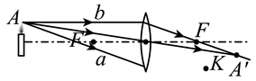

# Physics - 题目 2179

**ID**: 2d0e2f15e38e483b94eea8ae73d34051
**年级**: Grade 9
**难度**: Medium
**题型**: Comprehensive

## 题目
物点A发出两条光线经过凸透镜会聚于像点A′，请您在图中作出物点A发出的a光线经过凸透镜后的传播光路图；此时蜡烛成的是像（填“实”或“虚”）。​​​​​​​‌要想b线的折射光线经过K点，应使凸透镜沿主光轴水平向左还是水平向右移动？。

## 解答

1. 
2. [2]此时蜡烛成的像是由实际光线会聚而成的，所以是实像。
3. [3]要想b线的折射光线经过K点，应使b线的入射点，右侧透镜焦点F则和K点，这三点在一条直线上，折射光线应该向左移动，所以应使凸透镜沿主光轴水平向左移动。

## 知识点

**中文**:
  - 凸透镜和凹透镜作图
  - 凸透镜成像规律的应用

**English**:
  - Drawing Diagrams for Convex and Concave Lenses
  - Applications of Convex Lens Imaging

---
