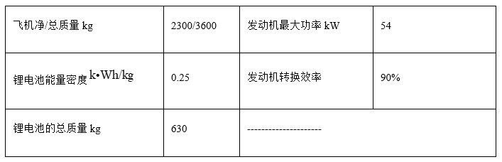
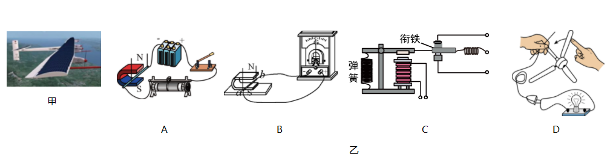

# Physics - 题目 2677

**ID**: 474a342cb29d4d95b1b1bd909467cbf3
**年级**: Grade 9
**难度**: Medium
**题型**: Comprehensive

## 题目
阅读短文，回答问题“阳光动力2号”太阳能飞机世界最大的太阳能飞机“阳光动力2号”（如图甲）飞机的表面使用一种碳纤维材料，其承载能力要比一般材料更好，但质量仅与一辆小型汽车相差无几，飞机上设有的通话、网络等设备，可随时保证飞机与地面的联系。​​​​​​​‌白天，飞机飞行高度达到海拔8500米，依靠两翼上安装的太阳能电池板为直流电动机提供动力，同时对锂电池充电以保证夜间或阴雨天不间断飞行，晚上，依靠储存在锂电池里的电能继续飞行。飞机的有关技术参数如表：（1）太阳能属于能源（选填“常规”或“新”），飞机表面的碳纤维材料具有硬度、小的物理特性，飞行过程中驾驶员依靠波（选填“超声”、“次声”或“电磁”）与地面进行通话联系；（2）图乙所示实验中，能反映电动机工作原理的是；（3）某次飞行消耗了锂电池总储存量的20%，则发动机输出的机械能为J，若这些机械能改由航空燃油来提供，不计能量损失，需要完全燃烧燃油kg，（已知航空燃油的热值为4.25×10^{7}J/kg）。

## 解答

1. （1）[1]太阳能是人类刚开始利用或正在着手开发的能源，属于新能源。
2. [2]飞机表面的碳纤维材料具有硬度大特点，是为了能够防止一些撞击。
3. [3]飞机表面使用的碳纤维强度大，承载力大，其密度小可以减小飞机质量。
4. [4]真空不能传声，电磁波可以在真空中传播，所以飞机不能依靠超声波或次声波与地面联系，而是依靠电磁波。
5. （2）[5]电动机的工作原理是通电导体在磁场中受力转动。
6. A．图乙中A的原理是通电导体在磁场中受到力的作用，故A符合题意；
7. B．图乙中B的原理是电磁感应现象，故B不符合题意；
8. C．图乙中B是电磁继电器的原理图，故C不符合题意，
9. D．图乙中D的原理是电磁感应现象，故D不符合题意。
10. 故选A。
11. （3）[6]由表格中数据可知，飞机的锂电池总的储存量
12. $W=0.25{\rm{k}}·{\rm{W}}{\rm{h}}{\rm{/}}{\rm{k}}{\rm{g}}\times {\rm{6}}{\rm{3}}{\rm{0}}{\rm{k}}{\rm{g}}=157.5{\rm{k}}{\rm{W}}{\rm{·}}{\rm{h}}$
13. 某次飞行消耗了锂电池总储存量的20%，则发动机输出的机械能
14. $W{{}_{机}}=20{\rm{\%}}\times 90{\rm{\%}}\times W{{}_{机}}=20{\rm{\%}}\times 90{\rm{\%}}\times 157.5\times 3.6\times 10{^{6}}{\rm{J}}=1.0206\times 10{^{8}}{\rm{J}}$
15. [7]不计能量损失，由题可知有
16. $Q{{}_{放}}=W{{}_{机}}=1.0206\times 10{^{8}}{\rm{J}}$
17. 根据 $Q{{}_{放}}=mq$ 可得需要完全燃烧燃油的质量
18. $m=\frac {Q{{}_{放}}}{q}=\frac {1.0206\times 10{^{8}}{\rm{J}}}{4.25\times 10{^{7}}{\rm{J}}{\rm{/}}{\rm{k}}{\rm{g}}}\approx 2.4{\rm{k}}{\rm{g}}$

## 知识点

**中文**:
  - 发电机的构造和原理
  - 热值及相关计算
  - 能量的转化
  - 新能源
  - 直流电动机的原理
  - 电磁波的传播与应用

**English**:
  - Structure and Principle of Generator
  - Calorific Value and Calculations
  - Transformation of Energy
  - New Energy Sources
  - Principle of DC Motor
  - Propagation and Application of Electromagnetic Waves

---
