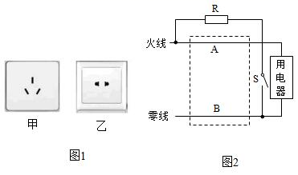

# Physics - 题目 1135

**ID**: 4b083c8362ed496088bff12eb59281a3
**年级**: Grade 9
**难度**: Medium
**题型**: Comprehensive

## 题目
(1)安装额定功率为1500W的电热水器时，需加装一个开关便于控制热水器的工作。​​​​​​​‌现有两种开关S_{1}（250V  6A）、S_{2}（250V  16A），为了安全和实用。应选用开关和图1中（填“甲”或“乙”）插座；(2)家庭电路用电器漏电时，通过火线与零线的电流不相等，漏电保护器中检测装置（在图中虚线框内，未画出）检测到这一差异后，便切断电源，起到保护作用。漏电保护器中另有试验电路，由开关S与电阻R组成，如图2，电路正常时用电器两端的电压为220V，当开关S（填“断开”或“闭合”）时就能模拟用电器漏电，此时通过A、B两处的电流I_{A}I_{B}（填“＞”“＝”或“＜”）；(3)电冰箱使用时外壳一定要地线，以保证安全。夏天，为了节能，可将冰箱的设置温度适当调（填“高”或“低”），有一台冰箱铭牌上标有“220V  150W”字样，测得其一天消耗的电能为 ${\rm{1}}{\rm{.}}{\rm{2}}{\rm{k}}{\rm{W}}\cdot {\rm{h}}$ ，假设冰箱在压缩机停止工作时不消耗电能，估算该冰箱压缩机在一天内工作的总时间为h。

## 解答

1. (1)[1][2]电热水器正常工作时的功率
2. $P=P{{}_{额}}={\rm{1}}{\rm{5}}{\rm{0}}{\rm{0}}{\rm{W}}$
3. 正常工作时的电流是
4. $I=\frac {P}{U}=\frac {{\rm{1}}{\rm{5}}{\rm{0}}{\rm{0}}{\rm{W}}}{{\rm{2}}{\rm{2}}{\rm{0}}{\rm{V}}}\approx {\rm{6}}{\rm{.}}{\rm{8}}{\rm{A}}$
5. 开关S_{1}允许的最大电流是6A，这个不合适，应该选择开关S_{2}；因为电热水器的外壳是金属外壳且在潮湿环境使用，为了防止其外壳带电时而发生的触电事故，应该选择三孔插座甲。
6. (2)[3]假设当开关S闭合时，会有电流流过电阻R，开关S，从图2可以看到，这情况下，流过火线的电流只有用电器的电流，而流过零线的电流即包括用电器的电流，也包括电阻R的电流，通过火线与零线的电流不相等，这时能模拟用电器漏电，所以当开关S闭合时就能模拟用电器漏电。
7. [4]通过A处的电流大小等于用电器的电流，通过B处的电流大小等于用电器的电流加上电阻R的电流，可知 $I{{}_{A}}<I{{}_{B}}$ 。
8. (3)[5]夏天为了节能，可将冰箱的设置温度适当调高些。
9. [6]由题意可知，冰箱的额定功率是150W，其一天消耗的电能是
10. $W={\rm{1}}{\rm{.}}{\rm{2}}{\rm{k}}{\rm{W}}\cdot {\rm{h}}=4.32\times {\rm{1}}{\rm{0}}{^{{\rm{6}}}}{\rm{J}}$
11. 其一天工作的时间是
12. $t=\frac {W}{P}=\frac {4.32\times {\rm{1}}{\rm{0}}{^{{\rm{6}}}}{\rm{J}}}{{\rm{1}}{\rm{5}}{\rm{0}}{\rm{W}}}=2.88\times {\rm{1}}{\rm{0}}{^{{\rm{4}}}}{\rm{s}}={\rm{8}}{\rm{h}}$
13. 则该冰箱压缩机在一天内工作的总时间为8h。

## 知识点

**中文**:
  - 电功率的计算及应用
  - 电路的动态分析

**English**:
  - Calculation and Application of Electric Power
  - Dynamic Circuit Analysis

---
