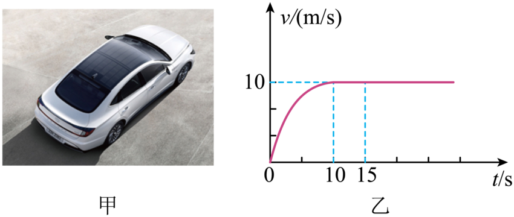

# Physics - 题目 1595

**ID**: 6dd3a66773bc4d1586b364c974ef6e9e
**年级**: Grade 9
**难度**: Medium
**题型**: Comprehensive

## 题目
如图甲是某新型太阳能汽车，该汽车的动力完全由安装在车顶的电池板收集的太阳能提供．接收太阳能的电池板面积为 $6{\rm{m}}{^{2}}$ 。​​​​​​​‌某次试车过程中，该车在水平路面上以恒定功率P做直线运动，其速度-时间图像如图乙所示。已知汽车（包括司乘人员）的总重为4800N，汽车行驶过程中所受阻力大小恒为车重的0.02倍（汽车运动过程中太阳光照情况不变）。（1）10-15s内汽车的功率P是多少W？0~15s内汽车牵引力做的功是多少J？（2）若电池板吸收太阳能的20%供给汽车牵引力做功，则0~15s吸收的太阳能是J，太阳光照射到电池板单位面积上的辐射功率是W。（3）若0~15s吸收的太阳能由燃烧干木柴来获得，则至少需要多少g干木柴？ $\left ({q=1.2\times 10{^{7}}{\rm{J}}/{\rm{k}}{\rm{g}}}\right )$

## 解答

1. （1）汽车行驶过程中所受的阻力
2. f=0.02G=0.02×4800N=96N汽车匀速直线行驶时，牵引力与阻力是一对平衡力，根据二力平衡条件可知汽车的牵引力
3. F=f=96N由图乙可知，汽车匀速行驶时的速度v=10m/s，则汽车的功率
4. $P=\frac {W}{t}=\frac {Fs}{t}=Fv=96{\rm{N}}\times 10{\rm{m}}/{\rm{s}}=960{\rm{W}}$ 由 $P=\frac {W}{t}$ 可知，0～15s内汽车牵引力做的功
5. W=Pt=960W×15s=14400J
6. （2）由 $η=\frac {W}{E}$ 可得0～15s吸收的太阳能
7. $E=\frac {W}{η}=\frac {14400{\rm{J}}}{20\%}=72000{\rm{J}}$ 吸热功率
8. $P{{}_{吸热}}=\frac {E}{t}=\frac {72000{\rm{J}}}{15{\rm{s}}}=4800{\rm{W}}$ 太阳光照射到电池板单位面积上的辐射功率为
9. $\frac {4800{\rm{W}}}{6}=800{\rm{W}}$
10. （3）由题知干木柴完全燃烧放出的热量
11. Q_{放}=E=72000J由Q_{放}=mq得需要干木柴的质量
12. $m{{}_{木柴}}=\frac {Q}{q}=\frac {72000{\rm{J}}}{1.2\times 10{^{7}}{\rm{J}}/kg}=0.006kg=6{\rm{g}}$

## 知识点

**中文**:
  - 功率的计算和估算
  - 功的计算和估算
  - 热值及相关计算

**English**:
  - Calculation and Estimation of Power
  - Calculation and Estimation of Work
  - Calorific Value and Calculations

---
