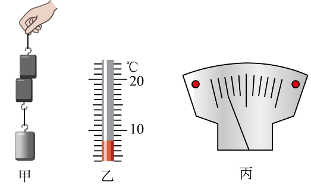

# Physics - 题目 1418

**ID**: 9c6041e30e014bee8d1934112081f536
**年级**: Grade 9
**难度**: Medium
**题型**: Comprehensive

## 题目
请补充以下实验内容：（1）如图甲所示，将两个铅柱的底面削平、削干净，然后紧紧地压在一起，两个铅柱就会结合起来，下面吊一个重物都不能把它们拉开，这说明分子间存在力。​​​​​​​‌若铅块压得不够紧，实验很难成功，这说明分子间作用力的大小与分子间的有关；（2）如图乙所示，温度计的示数是℃；（3）如图丙所示，测量物体质量前，首先调节天平横梁平衡，把游码拨至标尺最左端的零刻度线处，静止时发现指针情形如图丙所示，应将平衡螺母向（选填“左”或“右”）调节，使天平横梁平衡。

## 解答

1. （1）[1][2]将两个铅柱的底面削平、削干净，然后紧紧地压一起，两铅块就会结合起来，甚至下面吊一个重物都不能把它们拉开，说明分子间存在引力，若铅块压得不够紧，分子间的距离较大，分子间作用力小，实验很难成功，这说明分子间作用力的大小与分子间的距离有关。
2. （2）[3]图乙中温度计的分度值为1℃，因此图乙中的温度值为8℃。
3. （3）[4]静止时图丙中指针在分度盘中央的左侧，则右盘高，平衡螺母应向右调节。

## 知识点

**中文**:
  - 分子间的作用力
  - 质量的测量与天平的使用
  - 温度计的使用与读数

**English**:
  - Intermolecular Forces
  - Measurement of Mass and Use of Balance
  - Using and Reading Thermometers

---
