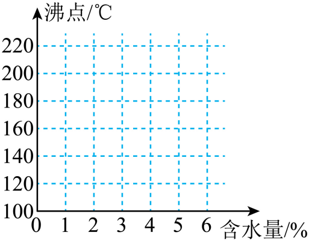

# Physics - 题目 484

**ID**: be9d4f735e404b93b44fd248eac51744
**年级**: Grade 9
**难度**: Medium
**题型**: Comprehensive

## 题目
汽车制动液俗称刹车油，汽车刹车时，驾驶员踩踏板通过刹车管线内的制动液把压力传递到刹车块，刹车块和车轮上的鼓轮摩擦，制止车轮转动，制动时因摩擦产生的热量会使制动液温度升高，如果温度过高，达到沸点，制动液就会产生大量气体，造成制动失灵。​​​​​​​‌制动液的沸点在遇潮吸水后会下降，因此国家规定制动液沸点不得低于140℃。如表为某种制动液的含水量和对应的沸点。含水量/%0123456沸点/℃210180158142132124120(1)刹车时，刹车块是通过方式增加内能；制动液温度会升高，这是通过方式增加了制动液的内能；(2)利用表格中给出的数据，在坐标图中作出沸点与含水量的关系图象；(3)当含水量约为时，这种制动液就必须更换。

## 解答

1. (1)制动时，刹车块和车轮上的鼓轮摩擦产生热量，刹车块是通过做功方式增加内能的。
2. 刹车时产生的热量会通过热传递传给制动液，使得制动液内能增加温度升高。
3. (2)利用描点法作图，如图：
4. 
5. (3)当制动液沸点为140℃时，对应的含水量约为3.2%，此时制动液必须更换。

## 知识点

**中文**:
  - 做功改变物体内能
  - 沸点及沸点与气压的关系

**English**:
  - Changing Internal Energy by Doing Work
  - Boiling Point and Air Pressure

---
