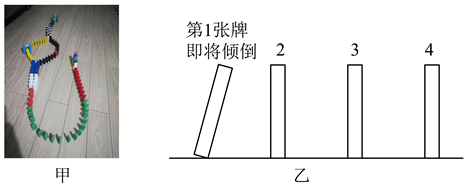

# Physics - 题目 589

**ID**: cb285b5347f74d828d5616e13a348a03
**年级**: Grade 9
**难度**: Medium
**题型**: Comprehensive

## 题目
多米诺骨牌是一种用木制、骨制或塑料制成的长方体骨牌，起源于中国北宋时期，由意大利传教士带往欧洲。​​​​​​​‌玩时将骨牌按一定间距排列成各种造型（如图甲），轻轻碰倒第一张骨牌，其余的骨牌就会产生连锁反应，依次倒下（如图乙）。多米诺骨牌效应的说法被广泛用来比喻许多社会现象。用物理学知识对多米诺骨牌效应发生过程进行分析：（1）在骨牌依次击倒的过程中，骨牌的重心如何变化：；（2）骨牌依次击倒，从能量的角度分析，涉及到不同形式的能量间的转化，请分析其中的能量转化情况：。

## 解答

1. （1）[1]实际上，每张骨牌的重心先微小提升，然后有明显的降低，整体而言重心是降低的。
2. （2）[2]骨牌倒下时质量不变，重心会降低，所以其重力势能会减小；重力势能减小后会使得骨牌倒下速度增大，动能增大，重力势能转化为了动能。

## 知识点

**中文**:
  - 动能和势能的转化
  - 重心

**English**:
  - Transformation between Kinetic and Potential Energy
  - Center of Gravity

---
