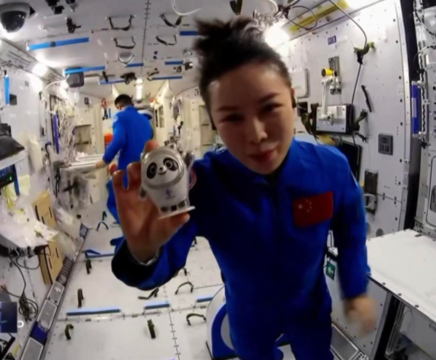

# Physics - 题目 1931

**ID**: d4c6a6b67dc24a33a2559bea00242284
**年级**: Grade 9
**难度**: Medium
**题型**: Comprehensive

## 题目
2021年10月16日神舟十三号载人飞船搭载长征运载火箭发射升空，返回舱于2022年4月16日安全着陆，飞行任务圆满成功。​​​​​​​‌由航天员们讲授的“天宫课堂”，更是极大地引起了同学们的好奇心。（1）“天宫”内的气压（填“大于”、“小于”或“等于”）“天宫”外的气压；（2）在外太空，重力影响可以忽略不计。王亚平老师给冰墩墩施加一个力，冰墩墩动起来，当冰墩墩离开王亚平老师的手后，我们看到冰墩墩将保持（选填“匀速直线运动”或“静止”）状态，此现象可以证明（选填“亚里士多德”或“伽利略”）关于力与运动的观点是错误的；（3）在“天宫课堂”第一次授课中，王亚平把纸做的小花放在水球上，小花就“盛开”了，那是因为纸和水分子间存在着力；（4）我国空间站运行的圆形轨道半径约为6700km，以约7.5km/s的飞行速度绕地球运行，则空间站绕地球一周的时间约（选填“0.5”、“1.5”或“3”）时，神舟十三号载人飞船和航天员乘组共绕飞地球约（选填“300”、“3000”或“30000”）圈。

## 解答

1. （1）[1]“天宫”内气压和地表气压差不多，而“天宫”外是真空，没有气压，因此“天宫”内气压大于“天宫”外气压。
2. （2）[2][3]冰墩墩动起来后离开王亚平老师的手，根据牛顿第一定律可知，运动的物体在不受外力作用时将保持匀速直线运动。此现象证明了物体的运动不需要力来维持，而亚里士多德说：力是维持物体运动的原因。所以此现象证明亚里士多德关于力和运动的观点是错误的。
3. （3）[4]因为水球表面水分子间的平均距离比内部分子间平均距离大，分子间表现为引力，所以小花在水球上，会由于纸和水分子间的引力而“盛开”。
4. （4）[5]由题意可知，我国空间站运行的圆形轨道半径约为
5. r=6700km=6.7×10^{6}m
6. 则空间站绕地球一周的周长
7. s=2πr=2×3.14×6.7×10^{6}m≈4.21×10^{7}m
8. 空间站的飞行速度
9. v=7.5km/s=7.5×10^{3}m/s
10. 则空间站绕地球一周所用的时间
11. $t=\frac {s}{v}=\frac {4.21\times 10{^{7}}{\rm{m}}}{7.5\times 10{^{3}}{\rm{m}}{\rm{/}}{\rm{s}}}\approx 5614{\rm{s}}\approx {\rm{1}}{\rm{.}}{\rm{5}}{\rm{6}}{\rm{h}}$
12. 所以，空间站绕地球一周的时间约1.5h。
13. [6]从2021年10月16日到2022年4月16日，空间站绕地运行时间为6个月，即
14. t′=6×30×24h=4320h
15. 空间站绕地一周所用时间约为1.5h，则4320h绕地约
16. $n=\frac {t^{′}}{t}=\frac {4320h}{1.5h}=2880\approx 3000$ （圈）
17. 所以神舟十三号载人飞船和航天员乘组共绕飞地球约3000圈。

## 知识点

**中文**:
  - 分子间的作用力
  - 速度公式及其应用
  - 力与运动的关系

**English**:
  - Intermolecular Forces
  - Velocity Formula and Applications
  - Relationship between Force and Motion

---
