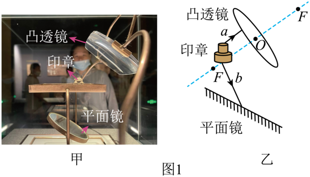
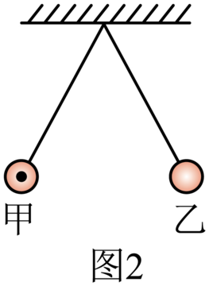
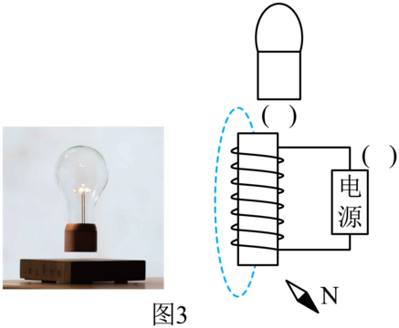

# Physics - 题目 1704

**ID**: 03881c441364449ab24f83224f4979a8
**年级**: Grade 9
**难度**: Medium
**题型**: Drawing

## 题目
（1）如图1甲所示是博物馆内“刘充国印”的展台，上方是凸透镜，透过它能看到放大的印章；下方是平面镜，通过它能看到印章底部的字。​​​​​​​‌图乙是其示意图，F为凸透镜的焦点，O为凸透镜的光心，光线a平行于凸透镜的主光轴（图中虚线）。请在图乙中画出：①光线a经过凸透镜折射后的光线；②光线b经过平面镜反射后的光线；（2）如图2用等长绝缘细线悬挂甲、乙两个完全相同的带电小球，静止时小球位置如图所示。请画出甲球受到的重力和乙球对甲球的作用力的示意图（力的作用点在球心）；（3）如图3是桌面摆件悬空灯泡，右图是其结构图。小磁针靠近底座静止时如图所示。请在图中标出：①灯泡底部的磁极（用“N”或“S”表示）；②电磁铁电源上方的极性（用“+”或“-”表示）；③磁感线的方向。

## 解答

1. （1）凸透镜能将平行光会聚到焦点，所以平行于主光轴的光线a经过凸透镜后，会聚于焦点；先过入射点做法线垂直于平面镜，由光的反射定律可得，反射角等于入射角，做出反射光线，如下图所示：
2. 
3. （2）分析可知，甲小球受到竖直向下的重力，根据电荷间相互作用的规律可知，甲小球受到乙球水平向左的斥力；过甲小球重心，分别沿各力的方向画一条有向线段，并分别用G、和F_{斥}表示，如图所示：
4. 
5. （3）①根据磁极间的相互作用规律，异名磁极相互吸引，通电螺线管的下端是N极，上端是S极。同名磁极互相排斥，灯泡才能悬起来，所以灯泡的底端也是S极；②根据安培定则，电源的上端是负极，下端是正极；③磁体周围的磁感线从N极发出，回到S极，如图所示：
6. 

## 知识点

**中文**:
  - 作光的反射光路图
  - 力的示意图与图示
  - 安培定则及其应用

**English**:
  - Drawing Reflection Ray Diagrams
  - Force Diagrams
  - Ampere's Rule and Applications

---
