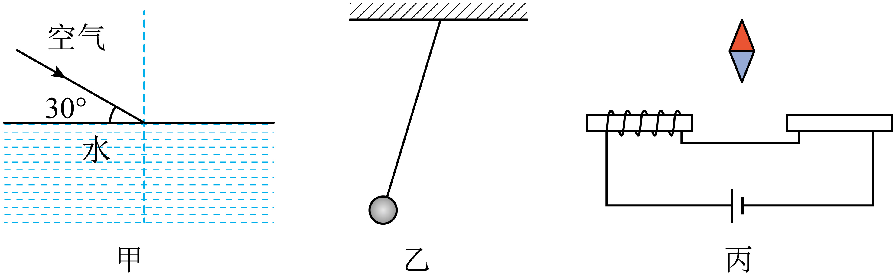

# Physics - 题目 551

**ID**: 0e8863138b4448db8b4ed1b39b271d5a
**年级**: Grade 9
**难度**: Medium
**题型**: Drawing

## 题目
（1）如图甲所示，一束光线从空气斜射到水面发生反射和折射，请在图中作出反射光线（标明反射角的度数）和折射光线的大致方向。​​​​​​​‌（2）一根细线下拴着2kg的小球，当小球摆到如图乙所示的位置时，画出小球受到的力的示意图。（3）请根据图丙中电流的方向，标出小磁针的N极并画出右端螺线管的绕线。

## 解答

1. （1）光在反射时，入射光线和反射光线分居法线两侧，反射角等于入射角，光从空气斜射入水中，折射光线和入射光线分居法线两侧，折射角小于入射角，如图所示：
2. 
3. （2）如图所示，小球受到重力和绳对它的拉力，重力的方向总是竖直向下的，如图所示：
4. 
5. （3）根据安培定则可知，左边螺线管的右端是S极，则小磁针的下方是N极，右端螺线管的左端是S极，如图所示：
6. 

## 知识点

**中文**:
  - 光学综合作图
  - 弹力和重力作图
  - 电磁作图

**English**:
  - Comprehensive Optical Drawing
  - Drawing Elastic and Gravity Force Diagrams
  - Electromagnetic Diagrams

---
