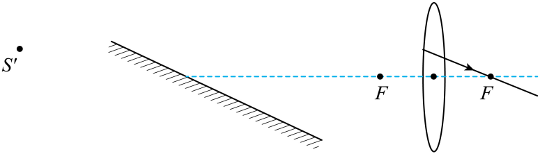

# Physics - 题目 2378

**ID**: 1296ff91e222470b8e7344ce20d63330
**年级**: Grade 9
**难度**: Medium
**题型**: Drawing

## 题目
如图所示，S'是点光源S在平面镜中所成的像，S发出的一条光线经过平面镜反射后射向凸透镜，最终过凸透镜的右焦点射出，请完成光路图并确定S点的位置（保留作图痕迹）。​​​​​​​‌

## 解答

1. 根据平面镜成像特点，作S'关于平面镜的对称点S，即为光源S的位置；由图可知，经凸透镜折射的光线过焦点，则凸透镜的入射光线应平行于凸透镜的主光轴，该光线与平面镜的交点为入射点O，连接S与入射点O，可得最初的入射光线，如图所示：
2. 

## 知识点

**中文**:
  - 光学综合作图

**English**:
  - Comprehensive Optical Drawing

---
