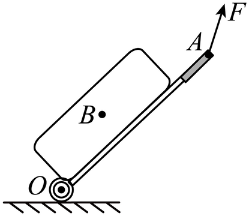
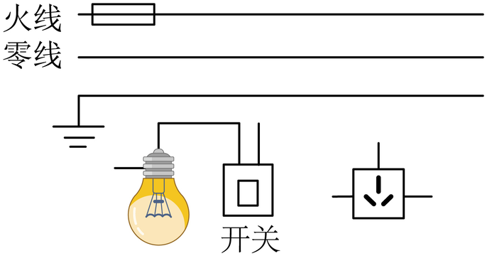

# Physics - 题目 2681

**ID**: 38d390c1fb434aa6b3324f93bdd397a8
**年级**: Grade 9
**难度**: Medium
**题型**: Drawing

## 题目
（1）快乐的寒假中，小明收拾好行李去旅行。​​​​​​​‌如图，行李箱可以视为杠杆，O为支点，B为重心，A为拉杆的端点，用拉力F使拉杆旅行箱在图示位置静止，请画出拉力F的力臂l；（2）如图，插座和电灯（带开关）是组成家庭电路的常用器件，请在遵守安全用电原则的前提下，用笔画线代替导线将器件分别正确连入电路中。

## 解答

1. （1）力臂是指支点到力的作用线的距离。图示中，将力F的作用线反向延长，过支点作延长线的垂线段即为对应的力臂l，如图所示：
2. 
3. （2）开关要控制电灯，则开关接在火线与电灯顶端金属点之间，电灯的螺旋套接零线；三孔插座的左孔接零线，右孔接火线，上孔接地线。如图所示：
4. 

## 知识点

**中文**:
  - 力和力臂的作图
  - 家庭电路的连接

**English**:
  - Drawing Force and Moment Arm Diagrams
  - Connection of Household Circuits

---
