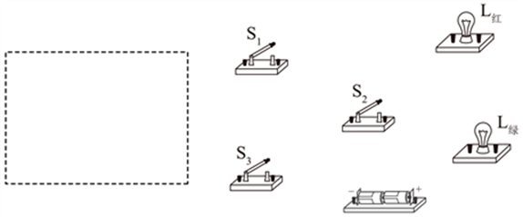

# Physics - 题目 1616

**ID**: 4b46b522aa4d4217b1da4bb41d75b84f
**年级**: Grade 9
**难度**: Medium
**题型**: Drawing

## 题目
某保密室有三道门，关上一道门相当于闭合一个开关。​​​​​​​‌只要有一道门没有关上红色和绿色的指示灯都会发光。当三道门都关上时，红灯会熄灭，只有绿灯会发光。请设计出符合要求的电路图画在虚线的方框内，并根据所设计的电路图在图中用笔画线将实物连接成符合要求的电路。（要求：连线不能交叉，线头接在接线柱上。）、

## 解答

1. 只要有一道门没有关上红色和绿色的指示灯都会发光。当三道门都关上时，红灯会熄灭，只有绿灯会发光，即两灯串联，开关闭合时将红灯短路，如图所示：
2. 
3. 将电路图接成实物图，如图所示：
4. 

## 知识点

**中文**:
  - 串、并联电路的设计

**English**:
  - Designing Series and Parallel Circuits

---
