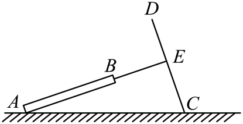
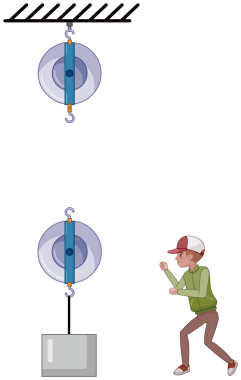

# Physics - 题目 2885

**ID**: 4b89f87f1e6c46fcb3649f87a09e6714
**年级**: Grade 9
**难度**: Medium
**题型**: Drawing

## 题目
（1）某学校一块指示牌被风刮倒后如图所示，请在图中画出将指示牌扶起的最小力F_{1}的示意图及其力臂L_{1}；（2）在地面上用如图的滑轮组提升重物，面出滑轮组最优的绕绳方式。​​​​​​​‌

## 解答

1. （1）要将指示牌扶起，支点为C，根据杠杆平衡条件可知，动力臂越长，动力越小，AC为最长动力臂L_{1}时，动力最小，从A点作垂直于AC向上的线段F_{1}的示意图。
2. （2）因为滑轮组要求工人站在地面上提升重物，因此，在绕绳时，最终的绳子自由端方向应该向下，由外向内画出绕绳方式，动滑轮由两段绳子承担物重。

## 知识点

**中文**:
  - 力和力臂的作图
  - 滑轮组的设计与组装

**English**:
  - Drawing Force and Moment Arm Diagrams
  - Design and Assembly of Pulley Systems

---
