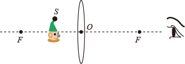

# Physics - 题目 2489

**ID**: 5ae33cb903be48a788f5f84e3f974df2
**年级**: Grade 9
**难度**: Medium
**题型**: Drawing

## 题目
小静在玩耍时透过爷爷的老花眼镜看到了小玩偶的像，请你在下图中作光路图确定玩偶S点所成像S′的位置。​​​​​​​‌图中O为老花镜的光心，F为其焦点。

## 解答

1. 老花眼镜是一个凸透镜，玩偶S点位于该透镜的一倍焦距以内，S点发出的无数条光中，照射到透镜上的光都会发生折射，这些折射光线或折射光线的反向延长线的交点就是S的像。作其中的两条特殊光线：过光心的光传播方向不变；平行于主光轴的光经凸透镜折射后折射光线过焦点。这两条光线的反向延长线的交点即S点的像S′，如图所示：
2. 

## 知识点

**中文**:
  - 作透镜的光路图
  - 凸透镜和凹透镜作图

**English**:
  - Drawing Ray Diagrams for Lenses
  - Drawing Diagrams for Convex and Concave Lenses

---
