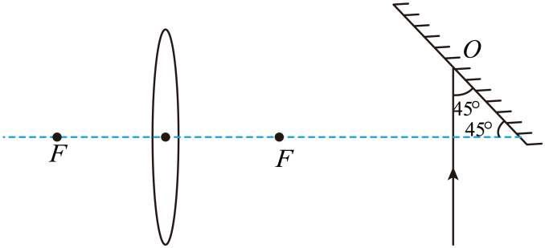

# Physics - 题目 2839

**ID**: 68b7954223524f39b80f6115d528c13f
**年级**: Grade 9
**难度**: Medium
**题型**: Drawing

## 题目
如图请做出光线经平面镜反射和凸透镜折射后的光路图。​​​​​​​‌

## 解答

1. 过入射点垂直于镜面画出法线，图中入射角为90°-45°=45°，再根据反射角等于入射角画出反射光线，可得反射光线平行主光轴；平行于主光轴的光线经凸透镜折射后折射光钱必过焦点。据此画出折射光线，如图所示：
2. 

## 知识点

**中文**:
  - 光学综合作图

**English**:
  - Comprehensive Optical Drawing

---
