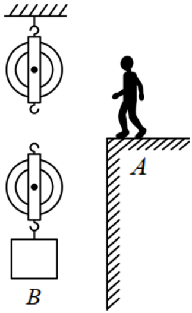

# Physics - 题目 2799

**ID**: 805e0c78afdd4eaeb52f169a370d7f63
**年级**: Grade 9
**难度**: Medium
**题型**: Drawing

## 题目
如图所示，某人站在A处通过一根绳和两个滑轮匀速提起物体B，所用的拉力 $F=100{\rm{N}}$ ，物体B重300N （不计滑轮重、绳重及摩擦力），画出滑轮组的绕线。​​​​​​​‌

## 解答

1. 不计滑轮重和绳重，不计摩擦力，由 $F=\frac {G}{n}$ 可知，承担物重的绳子段数 $n=\frac {G}{F}=\frac {300{\rm{N}}}{100{\rm{N}}}=3$ ，滑轮组由3段绳子承担物重。

## 知识点

**中文**:
  - 滑轮组的设计与组装

**English**:
  - Design and Assembly of Pulley Systems

---
