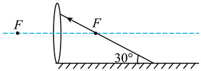

# Physics - 题目 1586

**ID**: 83d815ed5bc943999d83e3eddb945f3d
**年级**: Grade 9
**难度**: Medium
**题型**: Drawing

## 题目
如图所示，一束光线经平面镜反射后，过凸透镜的焦点F射向凸透镜，请在图中画出射向平面镜的入射光线和经凸透镜后的折射光线，并标出入射角的度数。​​​​​​​‌

## 解答

1. 过平面镜的反射点垂直镜面作出法线，因为反射光线与镜面的夹角为30°，则反射角为
2. 
3. 则入射角也为60°，根据入射角等于60°，在法线右侧作出入射光线，并标出入射角。过焦点的光线经凸透镜折射后折射光线平行于主光轴；如图所示：
4. 

## 知识点

**中文**:
  - 作光的反射光路图
  - 凸透镜和凹透镜作图

**English**:
  - Drawing Reflection Ray Diagrams
  - Drawing Diagrams for Convex and Concave Lenses

---
