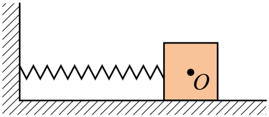

# Physics - 题目 2078

**ID**: 84eadb1354624f0bbf98f12b2cd5ec37
**年级**: Grade 9
**难度**: Medium
**题型**: Drawing

## 题目
弹簧的左端与墙固定连接，右端跟物块连接。​​​​​​​‌如图所示，某时刻物块正在光滑的水平面上向右加速滑动，画出物块此时受力的示意图（不计空气阻力）。

## 解答

1. 物块正在光滑的水平面上向右加速滑动，则它受到弹簧对它水平向右的弹力，此外，还受到竖直向下的重力和竖直向上的支持力，这两个力是一对平衡力，大小相等，它受到的力的作用点都画在它的重心上。

## 知识点

**中文**:
  - 力与运动的关系
  - 力的示意图与图示

**English**:
  - Relationship between Force and Motion
  - Force Diagrams

---
