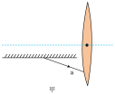
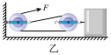

# Physics - 题目 2272

**ID**: 8507fd1018374dcc8aec233e2a8e1863
**年级**: Grade 9
**难度**: Medium
**题型**: Drawing

## 题目
请按要求完成下列作图。​​​​​​​‌（1）有一点光源S，它在平面镜中的像与凸透镜的焦点F重合，S发出的一条光线经平面镜反射后，反射光线为a，如图甲所示。请在图中画出：①凸透镜的焦点F；②点光源S的位置；③光线a经过凸透镜后的折射光线；（2）如图乙所示，用F=150N的力使木箱沿水平方向做匀速直线运动（不计滑轮重及绳与滑轮间的摩擦），请在图中画出木箱此时受到的摩擦力的示意图并标出摩擦力的大小。

## 解答

1. （1）平面镜的反射光线和光源的像在同一直线上，延长反射光线交于主光轴上即为焦点；根据凸透镜的焦点作对称点，就是光源S，过凸透镜焦点的光线经过折射后平行于主光轴，如图
2. 
3. （2）根据滑轮组绳子股数，当拉力为150N时，由于物体受到平衡力，则地面对物体的滑动摩擦力为300N，摩擦力的方向和物体运动方向相反，如图
4. 

## 知识点

**中文**:
  - 凸透镜和凹透镜作图
  - 平面镜成像的相关作图
  - 力的示意图与图示
  - 滑动摩擦力的大小
  - 滑轮组的设计与组装

**English**:
  - Drawing Diagrams for Convex and Concave Lenses
  - Drawing Plane Mirror Ray Diagrams
  - Force Diagrams
  - Magnitude of Sliding Friction
  - Design and Assembly of Pulley Systems

---
