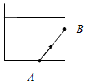

# Physics - 题目 2547

**ID**: 86a3b42f9e52485aba64a8798d1d50a2
**年级**: Grade 9
**难度**: Medium
**题型**: Drawing

## 题目
如图所示，容器底部发光点 $A$ 发出一束光，射向容器壁上的 $B$ 点并发生反射，其反射光经水面后发生折射，请画出容器壁上的反射光线和水面上折射光线的大致方向。​​​​​​​‌

## 解答

1. 由光的反射定律可知，光线在水中时，反射角等于入射角；由光的折射规律可知，光线从水中斜射入空气中，折射角大于入射角，折射光线远离法线偏折。如图所示：
2. 

## 知识点

**中文**:
  - 光学综合作图

**English**:
  - Comprehensive Optical Drawing

---
