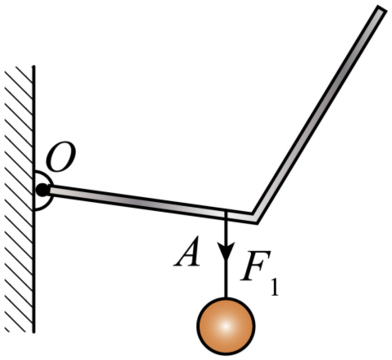

# Physics - 题目 1014

**ID**: e3157257a6294915a5f9b9f149da10e9
**年级**: Grade 9
**难度**: Medium
**题型**: Drawing

## 题目
如图所示，轻质杠杆的A点挂一个重物，绳的拉力为 $F{{}_{1}}$ ，O为杠杆的支点，以最小拉力 $F{{}_{2}}$ 使杠杆处于平衡状态。​​​​​​​‌请分别画出 $F{{}_{1}}$ 的力臂 $l{{}_{1}}$ 和最小拉力 $F{{}_{2}}$ 的示意图及力臂 $l{{}_{2}}$ 。

## 解答

1. F_{1}的力臂为过支点做F_{1}作用线的垂直；最小拉力F_{2}以杠杆右端点为阻力的作用点，连接右端点与支点O为最大阻力臂，过力的作用点做力臂的垂线为最小力，如下图所示：
2. 

## 知识点

**中文**:
  - 力和力臂的作图
  - 杠杆中最小力的问题

**English**:
  - Drawing Force and Moment Arm Diagrams
  - Minimum Force Problems in Levers

---
