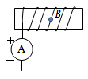

# Physics - 题目 2869

**ID**: e8cb6232e0c74b9e860c1a4937d5630a
**年级**: Grade 9
**难度**: Medium
**题型**: Drawing

## 题目
在图中标出通电螺线管的N极和B点的电流方向．(        )​​​​​​​‌

## 解答

1. 根据图中电流表的连接可知，则电流由右侧流入，则B点的电流方向向下，根据安培定则：用右手握住螺线管，使四指所指的方向为电流的方向，则大拇指所指的一侧为N极，即螺线管的右侧为N极，如图所示：
2. 

## 知识点

**中文**:
  - 安培定则及其应用

**English**:
  - Ampere's Rule and Applications

---
