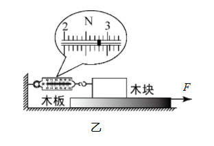

# Physics - 题目 652

**ID**: 02699784d75c44798575f6e0cc00e6a6
**年级**: Grade 9
**难度**: Medium
**题型**: Experiment

## 题目
在“探究影响滑动摩擦力大小因素”的实验中，小英做了如图甲所示的三次实验，用到了一个弹簧测力计、一个木块、一个砝码、两个材料相同但表面粗糙程度不同的长木板。​​​​​​​‌实验中第1次和第2次用相同的长木板，第3次用表面更加粗糙的长木板。（1）实验时用弹簧测力计沿水平方向拉动木块，使其在水平桌面上做匀速直线运动，根据原理，可知滑动摩擦力的大小（选填“大于”“等于”或“小于”）拉力的大小；（2）比较图甲1、2两次实验，得出的结论是：；（3）若要探究滑动摩擦力的大小与接触面粗糙程度的关系，应选择两次实验进行比较：（4）小芳同学将实验方法进行了改进，实验装置如乙所示：将弹簀测力计一端固定，另一端钩住木块，木块下面是一长木板，实验时拉着长木板沿水平地面向右运动，此时木块受到的摩擦力大小为N，这样改进的好处是；（5）若在图甲装置中，木块在运动过程中所受拉力突然变大，滑动摩擦力将（选填“变大”“变小”或“不变”）。

## 解答

1. （1）实验中要用弹簧测力计拉着木块做匀速直线运动，目的是使木块受到平衡力，根据二力平衡的知识可知，此时的拉力等于摩擦力。
2. （2）图甲1、2两次实验，接触面的粗糙程度相同，2中接触面所受的压力更大，测出的摩擦力更大，得出的结论是当接触面的粗糙程度相同时，接触面所受压力越大，滑动摩擦力越大。
3. （3） 探究滑动摩擦力的大小与接触面粗糙程度的关系，应控制接触面受到的压力相同，接触面粗糙程度不同，所以应选择2、3两次实验进行比较。
4. （4）木块始终处于平衡状态，拉力等于摩擦力，由弹簧测力计示数可知拉力是2.8N，所以摩擦力也是2.8N。
5. 因为木块与长木板之间的压力和接触面粗糙程度都不变，所以无论是否匀速拉动长木板，木块受到的摩擦力始终等于拉力。
6. （5）在图甲装置中，木块在运动过程中所受拉力突然变大，但由于接触面的粗糙程度和接触面所受的压力均不变，所以滑动摩擦力不变。

## 知识点

**中文**:
  - 影响滑动摩擦力大小因素的探究实验

**English**:
  - Experiment: Factors Affecting Sliding Friction

---
