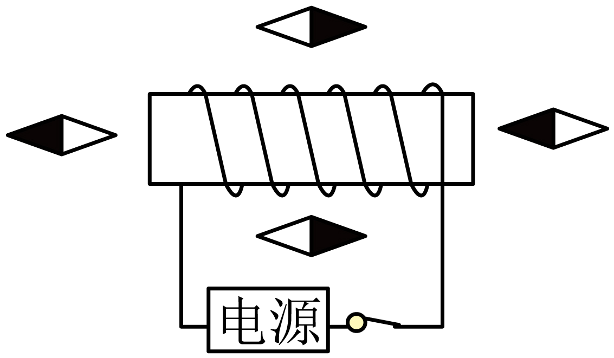

# Physics - 题目 349

**ID**: 044fffd6f2204ad28796553791e0610d
**年级**: Grade 9
**难度**: Medium
**题型**: Experiment

## 题目
在“探究通电螺线管外部磁场的方向”的实验中：（1）开关闭合前，小磁针均指南北，说明地球周围存在。​​​​​​​‌（2）关闭合后，小磁针的指向如图所示，可知：通电螺线管的左端为极；电源的左端为极。（3）将连接电源正、负极的导线对调，小磁针的指向也改变了，说明通电螺线管的磁场方向与方向有关。

## 解答

1. （1）[1]开关闭合前，可以观察到小磁针均指南北，说明地球周围存在磁场。
2. （2）[2] [3]开关闭合后，小磁针的指向如图所示，最左侧的小磁针的左端为N极、右端为S极，根据异名磁极相互吸引可知，螺线管的左端为N极、右端有S极。根据安培定则可知，电流从螺线管的右端流入，所以电源的左端为负极，右端为正极。
3. （3）[4] 将连接电源正、负极的导线对调，小磁针的指向也改变了，说明磁场的方向也发生了改变，所以说明通电螺线管的磁场方向与电流方向有关。

## 知识点

**中文**:
  - 通电螺线管的磁场

**English**:
  - Magnetic Field of Energized Solenoid

---
