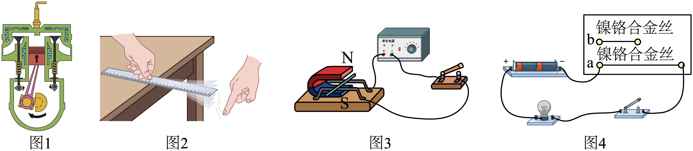

# Physics - 题目 424

**ID**: 04543647ab1f4bfa8234190fd8d76f17
**年级**: Grade 9
**难度**: Medium
**题型**: Experiment

## 题目
请完成下列填空。​​​​​​​‌（1）如图1，是四冲程汽油机的冲程示意图。（2）如图2，若保持拨动钢尺的力大小不变，逐渐增加钢尺伸出桌面的长度，听到声音的（选填“音调”“响度”或“音色”）变低。（3）如图3，该实验装置可以说明（选填“发电机”或“电动机”）的工作原理。（4）如图4，镍铬合金丝a、b的横截面积相同，接入电路的镍铬合金丝由a换成b后，小灯泡的亮度变亮，由此说明，其他条件相同时，导体长度越长，电阻越。

## 解答

1. （1）图中进气门和排气门均关闭，活塞向上运动，此为压缩冲程，机械能转化为内能。
2. （2）保持拨动钢尺的力大小不变，逐渐增加钢尺伸出桌面的长度，尺子振动频率变低，音调降低，故为音调发生改变。
3. （3）图3中有电源，通电导体在磁场中受到力的作用，可以说明电动机的工作原理。
4. （4）由题可知材料一定，横截面积一定，接入电路的镍铬合金丝由a换成b后，小灯泡的亮度变亮，即合金丝的电阻减小，这说明其他条件相同时，导体长度越长，电阻越大。

## 知识点

**中文**:
  - 内燃机的四个冲程
  - 影响导体电阻大小因素的探究实验
  - 磁场对通电导线的作用
  - 音调的探究实验

**English**:
  - Four Strokes of Internal Combustion Engines
  - Experiment: Factors Affecting Resistance
  - Effect of Magnetic Field on Energized Wire
  - Experiment: Investigating Pitch

---
