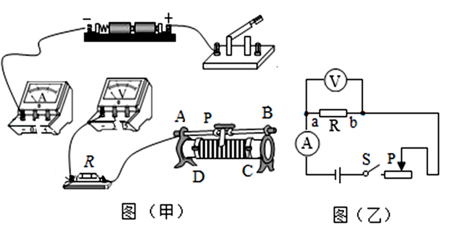

# Physics - 题目 415

**ID**: 07baa63468c44b1daceddfbb4fb6b622
**年级**: Grade 9
**难度**: Medium
**题型**: Experiment

## 题目
在“探究电流与电压的关系”的实验中，电源电压为3V，定值电阻为10Ω，滑动变阻器规格为“10Ω、3A”：(1)请根据图（乙）中电路图，用笔画线代替导线将实物图（甲）连接完整。​​​​​​​‌要求：使滑动变阻器的滑片P向右移动时，电流表的示数变小；（）(2)连接电路时，开关应，滑动变阻器的滑片P应放在端；（选填“A”或“B”）(3)通过定值电阻电流的变化范围是；(4)实验数据记录如表所示，分析实验数据可得：在电阻一定的情况下，通过导体的电流与导体两端的电压，理由是：。实验次序12345电压U/V1.61.82.02.22.4电流I/A0.160.180.200.220.24

## 解答

1. (1)[1]电源电压为3V，故电压表选用小量程与电阻并联，定值电阻为10Ω，变阻器连入电路的电阻为0时，由欧姆定律得，电路的电流最大为
2. $I{{}_{2}}=\frac {U}{R}=\frac {{\rm{3}}{\rm{V}}}{{\rm{1}}{\rm{0}}{\rm{Ω}}}{\rm{=}}{\rm{0}}{\rm{.}}{\rm{3}}{\rm{A}}$
3. 所以电流表选用小量程与电阻串联；使滑动变阻器的滑片P向右移动时，电流表的示数变小，即电阻变大，故变阻器左下接线柱连入电路中，如下图所示：
4. 。
5. (2)[2][3]为了保护电路，连接电路时，开关应断开，将滑动变阻器的滑片移至最大阻值处，即B端。
6. (3)[4]电源电压为3V，定值电阻为10Ω，滑动变阻器的最大电阻10Ω，由串联电路的规律及欧姆定律，电路的最小电流为
7. $I{{}_{1}}=\frac {U}{R{{}_{滑大}}+R}=\frac {{\rm{3}}{\rm{V}}}{{\rm{1}}{\rm{0}}{\rm{Ω}}{\rm{+}}{\rm{1}}{\rm{0}}{\rm{Ω}}}{\rm{=}}{\rm{0}}{\rm{.}}{\rm{1}}{\rm{5}}{\rm{A}}$
8. 电路的最大电流为0.3A，所以通过定值电阻电流的变化范围是0.15 $\sim $ 0.3A。
9. (4)[5][6]根据表中实验数据有
10. $ \frac {U{{}_{{\rm{V}}}}}{I}=\frac {{\rm{1}}{\rm{.}}{\rm{6}}{\rm{V}}}{{\rm{0}}{\rm{.}}{\rm{1}}{\rm{6}}{\rm{A}}}{\rm{=}}\frac {{\rm{1}}{\rm{.}}{\rm{8}}{\rm{V}}}{{\rm{0}}{\rm{.}}{\rm{1}}{\rm{8}}{\rm{A}}}=…{\rm{=}}\frac {{\rm{2}}{\rm{.}}{\rm{4}}{\rm{V}}}{{\rm{0}}{\rm{.}}{\rm{2}}{\rm{4}}{\rm{A}}}{\rm{=}}{\rm{1}}{\rm{0}}{\rm{Ω}}$
11. 为一定值，分析实验数据可得：在电阻一定的情况下，通过导体的电流与导体两端的电压成正比，理由是：电压与电流之比为定值。

## 知识点

**中文**:
  - 电流与电压关系的探究实验

**English**:
  - Experiment: Relationship between Current and Voltage

---
