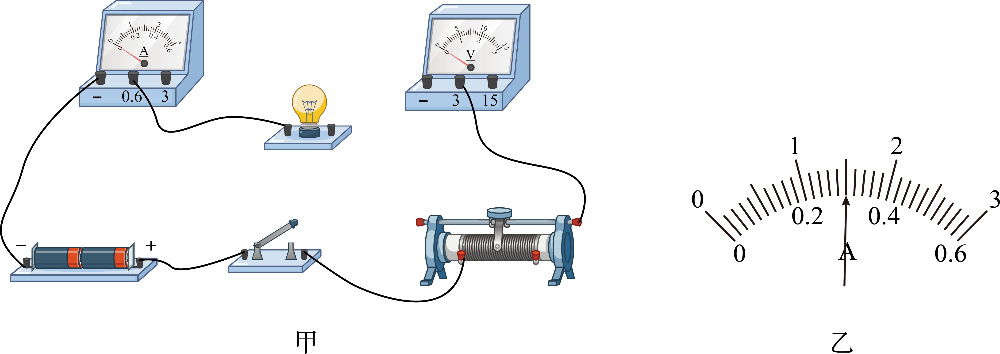

# Physics - 题目 429

**ID**: 097a5c0bb85b408aac906f1e9aefaf18
**年级**: Grade 9
**难度**: Medium
**题型**: Experiment

## 题目
小明同学在一次测量小灯泡额定功率的实验中，所用电源由两节新干电池串联组成，小灯泡上标有“ $2.5{\rm{V}}$ ”字样，滑动变阻器规格为“ ${\rm{1}}{\rm{0}}Ω$ ； ${\rm{0}}{\rm{.}}{\rm{5}}{\rm{A}}$ ”，连接了如图甲所示的电路。​​​​​​​‌（1）同组的小红发现小明忘记把电压表接入电路了，请把电压表正确接入电路中；（2）接好电路后，闭合开关，他们发现电压表示数较大，电流表示数为0，移动滑片也无法改变，若电路中只有一处发生故障（导线各连接处完好），他们分析后认为是发生了故障。（3）排除故障后，小明同学移动滑片，测得当电压表示数为 $2.5{\rm{V}}$ 时，电流表示数如图乙所示，则小灯泡的额定功率为W。（4）小明还想探究“在电压一定时，电流与电阻的关系”，于是将甲图中的小灯泡换成四个阻值分别为 ${\rm{1}}{\rm{0}}Ω$ ， ${\rm{8}}\Omega $ ， ${\rm{6}}Ω$ 和 ${\rm{4}}Ω$ 的定值电阻，其余连接均不改变。①在实验过程中，将4个定值电阻依次接入电路，调节滑动变阻器使定值电阻两端的电压保持某个值U不变，为了能够顺利得到4组I、R数据，完成实验，该电压U的取值范围是：。②四次实验中，当电压表调到某一控制电压时，滑动变阻器消耗的最大功率和最小功率之比是。

## 解答

1. （1）[1]连接电路时电压表应与小灯泡并联，采用正进负出的连接方法，电源电压为3V，故选择电压表的两成为0 $\sim $ 3V，连接电路如图所示
2. 
3. （2）[2][3]接好电路后，闭合开关，电流表示数为0，说明电路是断路，电路中无电流；电压表示数较大，说明电压表与电源之间的连接是通路，此时电压表测量的是电源电压，分析故障原因是小灯泡发生了断路。
4. （3）[4]如图乙所示，电流表选用的是小量程，分度值为0.02A，电流表的示数为0.3A，此时小灯泡的电压为额定电压为2.5V，根据功率公式计算可得小灯泡的额定功率为
5. P=UI=2.5V $\times $ 0.3A=0.75W
6. （4）①[5]滑动变阻器规格为“10Ω0.5A”， 当滑动变阻器接入电路的阻值最大为10Ω，同时定值电阻阻值最大也为10Ω时，此时定值电阻两端的电压最小为
7. $U{{}_{最小}}{\rm{=}}\frac {U}{R{{}_{总}}}{\rm{=}}\frac {{\rm{3}}{\rm{V}}}{{\rm{1}}{\rm{0}}{\rm{Ω}}{\rm{+}}{\rm{1}}{\rm{0}}{\rm{Ω}}}\times 10{\rm{Ω}}=1.5{\rm{V}}$
8. 滑动变阻器通过的电流最大为0.5A，此时电路中的电阻最小为
9. $R{{}_{最小}}{\rm{=}}\frac {U}{I{{}_{大}}}{\rm{=}}\frac {{\rm{3}}{\rm{V}}}{{\rm{0}}{\rm{.}}{\rm{5}}{\rm{A}}}=6{\rm{Ω}}$
10. 此时滑动变阻器阻值为2Ω，可用定值电阻的阻值为4Ω，其两端的电压最大为
11. $U{{}_{最大}}{\rm{=}}I{{}_{大}}R{\rm{=}}4{\rm{Ω}}\times 0.5{\rm{A}}=2{\rm{V}}$
12. 故电压U的取值范围是
13. 1.5V≤U≤2V
14. ②根据串联电路中电压规律可得滑动变阻器分得的电压为
15. U_{滑}= 3V-U
16. 当电压表调到某一控制电压时，滑动变阻器的电压保持不变，根据 $P=UI=\frac {U{^{2}}}{R}$ 可知，滑动变阻器消耗的最大功率和最小功率之比与变阻器连入电路的阻值成反比，根据分压原理得 $\frac {U{{}_{表}}}{U{{}_{滑}}}$ 为定值，当定值电阻分别取4Ω和10Ω时，对应的滑动变阻器接入电路的电阻之比为
17. $\frac {4Ω}{10Ω}{\rm{=}}\frac {2}{5}$
18. 即四次实验中，当电压表调到某一控制电压时，此时滑动变阻器消耗的最大功率和最小功率之比为5︰2。

## 知识点

**中文**:
  - 伏安法测量小灯泡的电功率
  - 电流与电阻关系的探究实验

**English**:
  - Measuring Bulb Power (Voltammetry)
  - Experiment: Relationship between Current and Resistance

---
