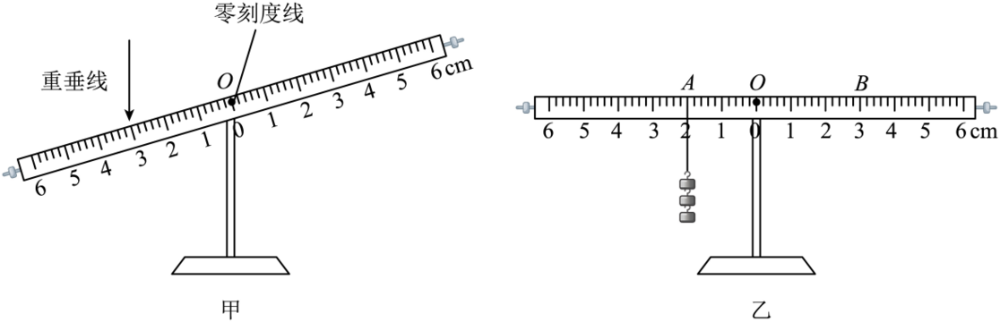

# Physics - 题目 264

**ID**: 09bf4fbc04b444d5bfd4317c57e5a8b1
**年级**: Grade 9
**难度**: Medium
**题型**: Experiment

## 题目
在“探究杠杆平衡条件”的活动中，实验选用的钩码重均为0.5N。​​​​​​​‌(1)实验前，杠杆静止在如图甲所示位置，应将向调节。把重垂线放置于 $O$ 点，从正前方观察，当零刻度线与重垂线（选填“重合”或“垂直”）时，即杠杆在水平位置平衡；(2)如图乙所示，需要在 $B$ 点挂上个钩码，杠杆将在水平位置平衡；再次在其两边各加上一个钩码，杠杆侧会下降；(3)多次实验，记录的数据如下表，可得 $F{{}_{1}}$ 、 $F{{}_{2}}$ 、 $L{{}_{1}}$ 、 $L{{}_{2}}$ 之间的关系是：。实验序号动力 $F{{}_{1}}/{\rm{N}}$动力臂 $L{{}_{1}}/{\rm{c}}{\rm{m}}$阻力 $F{{}_{2}}/{\rm{N}}$阻力臂 $L{{}_{2}}/{\rm{c}}{\rm{m}}$11.06.02.03.021.54.03.02.032.02.04.01.0(4)下列实验中多次测量的目的与本次探究不同的是。

## 解答

1. （1）实验前，杠杆静止在如图甲所示位置时，杠杆左低右高，应将杠杆两端的平衡螺母向右调节。从正前方观察，当零刻度线与重垂线重合时，说明杠杆已经在水平位置平衡。
2. （2）如图乙所示，设需要在B点挂n个钩码，杠杆将在水平位置平衡，根据杠杆的平衡条件可得 $3\times 0.5{\rm{N}}\times 2.0{\rm{c}}{\rm{m}}=n\times 0.5{\rm{N}}\times 3.0{\rm{c}}{\rm{m}}$ ，解得：n=2；再次在其两边各加上一个钩码，则 $(1+3)\times 0.5{\rm{N}}\times 2.0{\rm{c}}{\rm{m}}＜{\rm{(}}{{1}}{{+}}{{2}}{\rm{)}}\times {{0}}{{.}}{{5}}{\rm{N}}\times {{3}}{{.}}{{0}}{\rm{c}}{\rm{m}}$ ，杠杆右侧会下降。
3. （3）分析三次实验数据可知，每次实验，动力与动力臂的乘积都等于阻力与阻力臂的乘积，所以杠杆的平衡条件为 $F{{}_{1}}L{{}_{1}}=F{{}_{2}}L{{}_{2}}$ 。
4. （4）本实验多次实验的目的是避免偶然因素，寻找杠杆平衡条件的普遍规律。
5. A．测量铅笔长度，多次实验的目的是减小误差，目的与本次探究不同，故A符合题意；
6. B．探究重力与质量关系，多次实验的目的是得到重力与质量关系的普遍规律，故B不符合题意；
7. C．探究反射角与入射角关系，多次实验的目的是避免偶然因素，找到反射角和入射角关系的普遍规律，故C不符合题意。

## 知识点

**中文**:
  - 探究杠杆的平衡条件实验

**English**:
  - Experiment: Equilibrium Conditions of Levers

---
